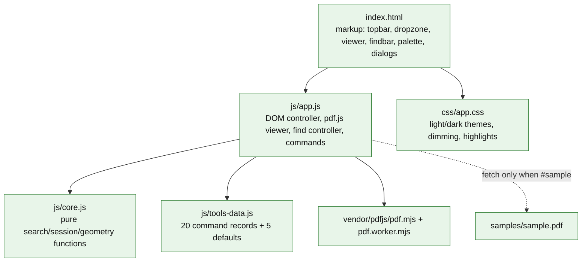
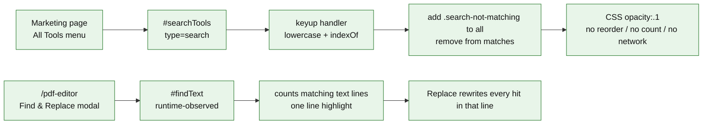

# 02 — Frontend architecture

**Phase:** 2 (frontend source analysis)
**Status:** **COMPLETE for the local prototype; PARTIAL for sejda.com**
**Targets:** `D:\small_editor\app` (source complete) and `site-re/sites/sejda-com/raw` (captured public frontend)

## 1. Two frontends, not one

| Attribute | Local `small_editor` | Captured sejda.com |
|---|---|---|
| Nature | Independent reimplementation | Public shipped frontend |
| Source | Readable ES modules | Minified/obfuscated bundles + HTML |
| Framework | None (vanilla DOM) | Not established; jQuery-style calls in shared bundle |
| Entry | `app/index.html` → `app/js/app.js` | Marketing pages + `/pdf-editor` |
| Routing | None; single page | Server-rendered routes (52 English routes captured) |
| Build | No bundler; files served directly | Production bundles; no source maps found |
| Completeness | Full source | Partial: no server code, no maps, obfuscated editor |

## 2. Local prototype architecture (CONFIRMED)

### 2.1 Module map



### 2.2 Responsibilities

| File | Responsibility | Evidence |
|---|---|---|
| `app/index.html` | Single-page shell; `#toolSearch`, `#findInput`, `#palette`, `#findBar`, `#viewer`, `#dropzone`, `#infoDialog`; no external script or stylesheet | source, 6,990 bytes |
| `app/js/app.js` | Loads pdf.js; renders canvases and highlight overlays; palette open/close/filter/pin/recents; find open/query/next/prev/options; zoom/fit; text export/copy; print; theme; info dialogs; keyboard handling | source, 34,660 bytes |
| `app/js/core.js` | Pure functions: `fold`, `isWordChar`, `toolHaystack`, `filterTools`, `pushRecent`, `togglePin`, `paletteEntries`, `orderByIds`, `buildLines`, `buildPageModel`, `findInPage`, `findInDocument`, `geometryForRange`, `rectToCss`, `stepIndex`, `describeMatches`, `countByPage` | source, 11,499 bytes |
| `app/js/tools-data.js` | 20 commands with `id`, `title`, `description`, `category`, `keywords`; defaults | source, 4,721 bytes |
| `app/css/app.css` | Layout, themes, `.is-dim` opacity 0.1, `.hit`/`.hit.current`, palette, responsive rules | source, 17,036 bytes |
| `app/vendor/pdfjs/` | pdf.js 4.10.38, worker, cmaps, standard fonts | `pdf.mjs` exports `pdfjsVersion = "4.10.38"` |
| `server.mjs` | Static file server; GET/HEAD only; port 5173; binds 127.0.0.1 by default | source, 3,082 bytes |

### 2.3 State and persistence

```js
// app/js/app.js (excerpt, identifiers only)
const STORE_KEYS = {
  pinned: "smallEditor.pinnedTools",
  recent: "smallEditor.recentTools",
  theme: "smallEditor.theme",
  dim: "smallEditor.dimMatches",
};
```

- `state` holds `pdf`, `pages`, `scale`, `fit`, `matches`, `index`, `query`, `matchCase`, `wholeWord`, `dimMatches`, `paletteOpen`, `searchTimer`, `loadToken`.
- Recents/pins/theme/dim preference persist in `localStorage`; reads and writes are wrapped in `try/catch` so private mode fails silently.
- There is no server-side state, no account, no cookie, no IndexedDB, no service worker.
- The only network request after page load is `fetch("../../samples/sample.pdf")` when the sample command is used; file-open uses `File.arrayBuffer()`.

### 2.4 Rendering model

1. `pdfjs.getDocument({ data, cMapUrl, standardFontDataUrl })`.
2. Each page renders to a `<canvas>` at the current scale; an absolutely positioned overlay holds highlight boxes.
3. `page.getTextContent()` items are clustered by baseline into line runs by `buildLines()`.
4. `findInDocument()` returns character ranges; `geometryForRange()` maps a range to proportional rectangles; `rectToCss()` flips PDF coordinates to CSS pixels.
5. All hits are painted; exactly one carries `.current`; non-current hits may be dimmed (`dimMatches`).
6. Lazy rendering uses an `IntersectionObserver`; `MAX_HIGHLIGHTS = 1500` caps overlay nodes.

### 2.5 Error/loading states

| State | Behaviour |
|---|---|
| No PDF | Dropzone visible; find count “Open a PDF” |
| Loading | `docMeta` “Loading…”; find count “Indexing…” while page text is indexed |
| Parse failure | Toast “That file could not be read as a PDF”; console error |
| Wrong file type | Toast “Please choose a PDF file” |
| No matches | Find count “No matches”; meta suggests widening options |
| LocalStorage blocked | Silent fallback; recents/pins are session-only |

## 3. Captured sejda.com frontend (PARTIAL)

### 3.1 Page families

| Family | Examples | What was captured |
|---|---|---|
| Marketing/tool landing pages | `/`, `/merge-pdf`, `/compress-pdf`, … | Server HTML, CSS, shared JS |
| Editor | `/pdf-editor` | HTML (289,503 B), obfuscated JS (394,992 B) |
| Pricing/products | `/upgrade`, `/desktop`, `/html-pdf-api` | Rendered pricing and plan data |
| Auxiliary | `/workflows`, `/developers`, `/help`, `/teachers` | HTML and rendered text |

The sitemap contains **1,396 URLs** (28 locale prefixes × 48 routes + 52 non-localised routes), per `claims.csv` C-0031. The All Tools panel contains **49 anchors = 44 unique tool routes + 5 cloned recents** (C-0003/C-0004).

### 3.2 Shared bundle structure

- `libs-and-partials.real.js`: **803,543 bytes**, minified; contains jQuery-style `keyup` binding and the exact tool-filter handler.
- `pdf-editor.min.js`: **394,992 bytes**, obfuscated; DOM ids are resolved through a string table, so literal grep for `searchStatus`, `findText`, `replaceMatchCase`, `searchReplaceTextPrompt`, `btn-replace-all` found nothing (C-0045).
- `index.min.css`: **162,057 bytes**; contains `.mega-menu li a.search-not-matching { opacity: .1 }`.
- No source maps were found in the captured artifacts.

### 3.3 Search surfaces



The exact tool-filter handler and runtime matrix are documented in `site-re/sites/sejda-com/report.md`; the source excerpt is in `raw/libs-and-partials.real.js` (`art_17dea15b…`). The editor find algorithm could not be read statically; only runtime behaviour is observed (C-0046, U2).

### 3.4 What is *not* established

- Framework identity/version of the Sejda frontend (only “minified jQuery-style code” is confirmed).
- Whether the editor uses a component framework, virtual DOM, or direct DOM mutation.
- Source maps, original file names, or build configuration.
- Any server-rendered feature flag that explains why `#searchTools` is `display:none` in the captured render (U1).
- The editor's tokenisation, line grouping, OCR/canvas text source, and handling of rotated/ligature text (U2).

## 4. Phase 2 conclusion

The local prototype is fully readable and architecturally simple: **HTML + ES modules + pdf.js + a Node static server**. The Sejda capture is a real but **partial** frontend: enough to prove the tool-filter behaviour and observe the editor's find behaviour, not enough to reconstruct the frontend source or the backend. No source maps or server code exist in scope.
