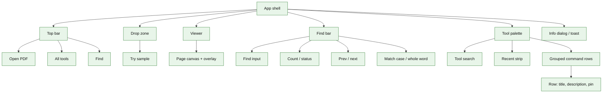

# 03 — Page and component inventory

**Phase:** 2 (page/component catalog)
**Status:** **COMPLETE for the local single-page app; PARTIAL for the captured Sejda pages**
**Scope:** `D:\small_editor\app` and the 52 English Sejda routes enumerated in `site-re/sites/sejda-com/inventory.md`

## 1. Local `small_editor`: one page, six regions

**Route:** `/app/` (server redirects `/` → `/app/`).
**Entry:** `app/index.html`.
**Framework:** none.

| Region | IDs / selectors | Purpose | Source |
|---|---|---|---|
| Skip link | `.skip-link` → `#pages` | Keyboard bypass | `index.html` |
| Top bar | `.topbar`, `#toolsBtn`, `#findBtn`, `#openBtn`, `#fileInput`, `#docName`, `#docMeta` | Brand, open, find, tool palette trigger | `index.html`, `app.js` |
| Drop zone | `#dropzone`, `#dropOpenBtn`, `#sampleBtn`, `.privacy-note` | Empty state; browse/drop/sample | `index.html`, `app.js` |
| Viewer | `#viewer`, `#pages`, `.pdf-page`, `canvas`, highlight overlay | Lazy multi-page PDF rendering | `app.js` |
| Find bar | `#findBar`, `#findInput`, `#findCount`, `#findMeta`, `#prevBtn`, `#nextBtn`, `#caseBtn`, `#wordBtn`, `#closeFind` | Occurrence-level find | `index.html`, `app.js`, `core.js` |
| Tool palette | `#palette`, `#toolSearch`, `#toolSearchClear`, `#recentStrip`, `#paletteBody`, `#suggestBtn` | Filter/dim, pins/recents, command runner | `index.html`, `app.js` |
| Overlays | `#toast`, `#infoDialog`, `#infoTitle`, `#infoBody` | Status and static help | `index.html`, `app.js` |

### 1.1 Command catalogue (20)

From `app/js/tools-data.js`; each command is a real implemented action, not a marketing link.

| # | ID | Title | Category | Implemented by |
|---|---|---|---|---|
| 1 | `open-file` | Open PDF | File | `fileInput.click()` |
| 2 | `open-sample` | Open sample PDF | File | `loadSample()` |
| 3 | `find` | Find in document | Search | `openFind()` |
| 4 | `find-next` | Next match | Search | `moveMatch(1)` |
| 5 | `find-previous` | Previous match | Search | `moveMatch(-1)` |
| 6 | `match-case` | Toggle match case | Search | `toggleFindOption("matchCase")` |
| 7 | `whole-word` | Toggle whole word | Search | `toggleFindOption("wholeWord")` |
| 8 | `clear-search` | Clear search | Search | `clearSearch({ close: true })` |
| 9 | `download-text` | Export text | File | `downloadText()` |
| 10 | `copy-text` | Copy page text | Edit | `copyPageText()` |
| 11 | `zoom-in` | Zoom in | View | `setZoom(+0.15)` |
| 12 | `zoom-out` | Zoom out | View | `setZoom(-0.15)` |
| 13 | `fit-width` | Fit width | View | `setZoom(fitScale(), true)` |
| 14 | `first-page` | First page | Navigate | `scrollToPage(0)` |
| 15 | `last-page` | Last page | Navigate | `scrollToPage(last)` |
| 16 | `toggle-dim` | Toggle dimmed matches | Search | body class + localStorage |
| 17 | `toggle-theme` | Toggle theme | View | `applyTheme()` |
| 18 | `print` | Print | File | `window.print()` |
| 19 | `shortcuts` | Keyboard shortcuts | Help | static dialog |
| 20 | `about` | About Small Editor | Help | static dialog |

Defaults: `DEFAULT_PINNED = ["open-file","find","open-sample","download-text","toggle-theme"]`, `DEFAULT_RECENT = ["find"]`.

### 1.2 Local page inventory

There is exactly **one** HTML page. There are no client-side routes, no nested layouts, no server-rendered pages, and no 404 page in the client. The Node server has a plain-text 404.

## 2. Captured Sejda pages

### 2.1 Route families

| Family | Captured examples | Count / status |
|---|---|---|
| Home/marketing | `/` | 1 captured render |
| Tool pages | 44 unique routes from the All Tools menu | Menu + sitemap enumerated; a subset rendered |
| Editor | `/pdf-editor` | HTML + screenshot + fixture upload |
| Account/auth | `/login`, `/reset-password`, `/account` | Login UI captured; account gated, not opened |
| Pricing/products | `/upgrade`, `/desktop`, `/html-pdf-api`, `/workflows`, `/developers`, `/help`, `/teachers` | Rendered pricing/text captured |
| Legal/press | in sitemap | Enumerated, not all rendered |

Sitemap: **1,396 URLs** (28 locales × 48 routes + 52 English routes). See `site-re/sites/sejda-com/inventory.md` §2.

### 2.2 The 44 tool routes (captured menu)

| Group | Tools |
|---|---|
| Compress | Compress |
| Edit & Sign | Edit, Fill & Sign, Create Forms, Delete Pages |
| Merge | Merge, Alternate & Mix, Organize |
| Split | Extract Pages, Split by pages, Split by bookmarks, Split in half, Split by size, Split by text |
| Security | Protect, Unlock, Watermark, Flatten |
| Convert from PDF | PDF to Excel, PDF to JPG, PDF to PowerPoint, PDF to Text, PDF to Word |
| Convert to PDF | HTML to PDF, JPG to PDF, Word to PDF |
| Other | Crop, Bates Numbering, Create Bookmarks, Edit Metadata, Extract Images, Flip, Grayscale, Header & Footer, N-up, Page Numbers, Rename, Repair, Resize, Rotate, Remove annotations |
| Scans | Deskew, OCR |
| Automate | Workflows |

That is **44 unique routes**; the menu renders **49 anchors** because five popular tools are cloned into “Recent” (Compress, Edit, Extract Pages, Merge, Crop). Exact route/description table: `site-re/sites/sejda-com/inventory.md` §4.1, evidence `art_9d3944df…`.

### 2.3 Sejda page components

| Component | Where | Observed behaviour |
|---|---|---|
| Header / brand | all pages | `a.more-tasks` opens the All Tools mega-menu |
| Mega-menu | homepage/editor | 6 columns, 12 rows, 11 named groups, 49 anchors, Recent clones |
| Tool search | inside mega-menu | `#searchTools`, placeholder “Type to search”; hidden by inline `display:none` in capture |
| Tool links | mega-menu | `<li><a>` with title/`data-original-title`; filtered by class, not removed |
| Pricing cards | `/upgrade`, `/desktop` | 3 web cards, 2 desktop cards, free tier |
| API tiers | `/html-pdf-api` | 7 monthly tiers + self-hosted option |
| Editor toolbar | `/pdf-editor` | Tool groups; Find & Replace menu item only reachable after a PDF loads |
| Find & Replace modal | `/pdf-editor` | `#findText`, `#replaceText`, `#searchStatus`, Replace/Replace all, Match case, Include links |
| Upload input | tool pages/editor | `input.fileupload`, accepts `.pdf`; fixture upload observed |
| Login form | `/login` | Google Sign-In button + email/password UI; not exercised |

### 2.4 Editor find component geometry (observed)

- Modal title: “Find & Replace”.
- Find input rendered at about **199 × 34 px**.
- Status text: `Found N match(es) on page P`.
- One `.find-replace-highlight` element for the current match; it spans the matched **text line** (about **284.6 px** wide at **15.33 px** font).
- Options: Match case default **unchecked**; Include links default **checked**.
- Replace rewrites every occurrence inside the matched line.

Evidence: `art_8a99c539…`, `art_068373d6…`, `art_b0a086ba…`; claims C-0021–C-0030.

## 3. Component hierarchy (local, CONFIRMED)

## 4. Coverage boundaries

- **Local:** every source file was read; every command is implemented; no dead routes.
- **Sejda:** every **English route in the sitemap was enumerated**, but not every route was rendered. The All Tools menu is the broader tool source (44 routes) and was opened. Login/account, checkout, and server-side processing were not exercised.
- **Not covered:** non-English locales, blog sitemap, press/legal pages beyond enumeration, unlinked/experimental tools, and any authenticated surface.

## 5. Evidence

| Item | Evidence |
|---|---|
| Local markup | `app/index.html` (SHA-256 `d585e479…`) |
| Local commands | `app/js/tools-data.js` (`c9db2f65…`) |
| Local behaviour | `app/js/app.js` (`406b8c85…`), `app/js/core.js` (`291d7453…`) |
| Sejda 49 anchors / 44 routes | `art_9d3944df…`, `ev_4073c716…` |
| Sejda editor modal | `art_e13a2c04…`, `art_8a99c539…` |
| Sejda sitemap | `art_8558ddab…` |
| Sejda pricing | `art_c5ef10a4…`, `art_8316d6c6…`, `art_2c04102d…` |
