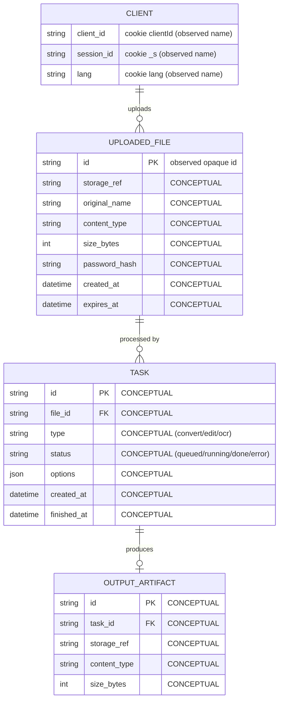

# 11 — Database and data model

**Phase:** 5 (database/data model)
**Status:** **N/A for the local prototype; CONCEPTUAL ONLY for sejda.com**
**Constraint:** No database connection, schema dump, migration, ORM mapping, or query log was available.

## 1. Local `small_editor`: no database

**CONFIRMED.** There is no database engine, driver, schema, migration, or SQL in the workspace.

State lives in:

| State | Storage | Lifetime |
|---|---|---|
| Open PDF bytes / parsed document | Browser memory (`state.pdf`, pdf.js) | Tab session |
| Page models / matches | Browser memory | Tab session |
| Pinned tools | `localStorage["smallEditor.pinnedTools"]` | Until cleared |
| Recent tools | `localStorage["smallEditor.recentTools"]` | Until cleared |
| Theme | `localStorage["smallEditor.theme"]` | Until cleared |
| Dim preference | `localStorage["smallEditor.dimMatches"]` | Until cleared |
| Export | Blob download | User-controlled |

No user records, no uploads, no server-side persistence, no cookies.

## 2. Captured sejda.com: no actual schema

**UNKNOWN:** database engine, version, ORM/query library, tables, columns, keys, indexes, constraints, migrations, transactions, connection pooling, retention, tenancy, audit logging, and access controls.

What is observed is only the **public contract**:

- Upload returns an opaque id: `{"id":"<uuid>-<suffix>"}`.
- The client references `/api/files/{id}/password` and `/api/tasks/{id}`.
- Cookies `clientId`, `_s`, `lang` exist; their server-side meaning is unknown.
- No database error, SQL, schema, or migration was exposed.

## 3. Conceptual model (NOT the production schema)

The following is a **design hypothesis** derived from the observed API and UI. It is intentionally minimal and must not be presented as the vendor's schema.

**Legend:** only the opaque ids and the endpoint/cookie names are observed. Every field marked `CONCEPTUAL` is a design hypothesis, not a production fact. The actual relationships may differ completely.

### 3.1 Why this model is plausible

- `upload` returns a file id, so a file record or object key exists.
- `DELETE /api/tasks/{id}` implies a task resource.
- A password endpoint implies per-file protection state.
- The UI has task/progress language (not fully captured), suggesting asynchronous processing.

### 3.2 Why it may be wrong

- The backend may be stateless, storing files in object storage and metadata in a queue/cache.
- “Task” may be a client-side label over a synchronous conversion.
- The id suffix may encode tenant/purpose rather than a database key.
- No table names, columns, or relationships were observed.

## 4. What would establish the real model

| Priority | Artifact | What it would reveal |
|---|---|---|
| P0 | Flyway/Liquibase migrations or SQL dump | Tables, columns, constraints, indexes |
| P0 | JPA entities / repository interfaces | ORM mappings and relationships |
| P1 | Sanitized datasource config | Engine/version, pool, schema |
| P1 | Authorized read-only DB access | Actual schema and row shapes (no personal data) |
| P2 | Retention/cleanup job code or docs | TTL and deletion semantics |
| P2 | Queue/storage configuration | Whether metadata is in DB, cache, or object store |

## 5. Data protection notes

- The observed upload was a **3 KB test fixture**, not a private document.
- No user records were queried.
- Cookie values were not recorded.
- The conceptual model contains no personal data fields by design.
- Any future database inspection must be read-only, authorized, and limited to schema/metadata unless explicit approval covers data.

## 6. Phase 5 conclusion

There is **no database in the local application** and **no actual schema for sejda.com**. The ER diagram above is a labelled hypothesis, useful for an independent implementation, not evidence of production design.
