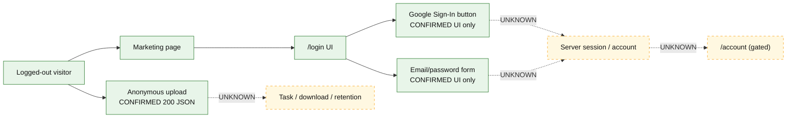

# 12 — Authentication and authorization

**Phase:** 6 (authn/authz)
**Status:** **N/A for the local prototype; OBSERVED LOGGED-OUT SUBSET for sejda.com**
**Constraint:** No login, account creation, password reset, MFA, or privilege escalation was attempted.

## 1. Local `small_editor`: no authentication

**CONFIRMED.** The local app has:

- no login/logout, no accounts, no users, no roles
- no cookies, sessions, JWTs, OAuth, or identity provider
- no CSRF tokens (because there is no state-changing server API)
- no authorization middleware
- no server-side data

It binds to `127.0.0.1` by default and serves static files. The only “identity” is the browser profile’s `localStorage`.

**Security consequence:** there is nothing to authenticate to. The relevant risks are local file handling and static-server robustness, covered in `16-security-and-quality-review.md`.

## 2. Captured sejda.com: logged-out surface

### 2.1 Observed

| Item | Observation | Evidence |
|---|---|---|
| Login UI | `/login` shows Google Sign-In plus email/password form | `art_d3ea633b…` (homepage head) / login page in capture |
| Google identity | `google-signin-client_id` meta on homepage | `art_d3ea633b…` |
| Facebook identity | `fb:app_id` meta on homepage | `art_d3ea633b…` |
| Account page | `/account` linked from header, login-gated; **not opened** | inventory §2 |
| Cookies on logged-out session | `clientId` (persistent), `_s` (session), `lang` (persistent) | `art_47c57f36…` |
| Cookie flags | all three **non-HttpOnly**, `Secure=false` in captured context | `art_47c57f36…` |
| Servlet session cookie | **no `JSESSIONID` observed** | `art_47c57f36…` |
| Upload auth | 3 KB fixture uploaded while logged out; `200` JSON | `art_47c57f36…` |
| Upload `Set-Cookie` | **none observed** | `art_47c57f36…` |
| Auth error responses | not exercised | — |
| MFA / password reset / email verification | not exercised | — |
| Roles / ownership checks | not exercised | — |
| CSRF / CORS policy | not assessed | — |
| Rate limiting / lockout | not exercised | — |

### 2.2 What the cookies do and do not prove

- `clientId` looks like an anonymous client identifier, but its server-side use is **UNKNOWN**.
- `_s` is a session-scoped cookie, but it is **not** `JSESSIONID`; it may be an application session, an edge cookie, or something else.
- `lang` is a locale preference.
- `Secure=false` and `HttpOnly=false` are observed flags; whether this is representative of production HTTPS behavior is **UNKNOWN** (the capture context and edge may affect flags).
- No conclusion about server language can be drawn from cookie names.

### 2.3 Authentication flow (observed vs unknown)

Only the solid nodes were observed. Everything after the login form is unknown.

### 2.4 Authorization questions that remain open

| Question | Status | Why it matters |
|---|---|---|
| Are uploads tied to a client/session? | UNKNOWN | Determines whether an id is guessable/shareable |
| Can another client access `/api/files/{id}`? | UNKNOWN | Object-level authorization |
| Who can delete a task? | UNKNOWN | Task ownership |
| Are there roles (free/pro/business)? | UNKNOWN | Pricing suggests tiers, but no account was exercised |
| How are password-protected files authorized? | UNKNOWN | `/api/files/{id}/password` not exercised |
| Is there CSRF protection on state-changing calls? | UNKNOWN | No authenticated session tested |
| Is there rate limiting/lockout? | UNKNOWN | No load or brute-force tests |
| Are admin surfaces separate? | UNKNOWN | Not enumerated; would be out of scope |

No attempt was made to answer these by bypassing controls.

## 3. Security implications (bounded)

- **Anonymous upload is observed.** That is a product decision, not necessarily a vulnerability. The endpoint accepted a 3 KB PDF and returned an id. Abuse resistance (rate limits, malware scanning, retention) is unknown and should be assessed by the owner.
- **Cookie flags** (`Secure=false`, `HttpOnly=false`) are worth reviewing in the real HTTPS context; the capture cannot prove production flags.
- **No `JSESSIONID`** is not evidence of “no Java”; stateless/token-based Java services and custom session cookies are common.
- **No auth bypass was attempted.** The account area, checkout and task lifecycle remain unexercised.

## 4. What would establish the auth model

1. Authorized test account with documented scope.
2. Login/logout/session-expiry observations (no credential capture in reports).
3. Authenticated request/response headers and cookies (values redacted).
4. Authorization matrix: anonymous vs free vs paid vs owner vs other user.
5. CSRF/CORS behavior on state-changing endpoints.
6. Password-reset and MFA flows, if in scope.
7. Backend Security configuration (if source/JAR supplied).

## 5. Phase 6 conclusion

The local app has **no auth**. For sejda.com, only the **logged-out UI and anonymous upload** are observed; the authentication and authorization model is **UNKNOWN**. The **web-backend** Java claim cannot be supported or refuted from the cookie names or login UI. The official SDK/PDF engine is separately confirmed Java, but it contains no auth code.
