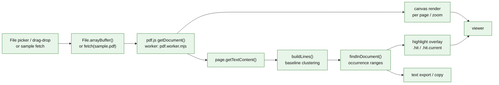
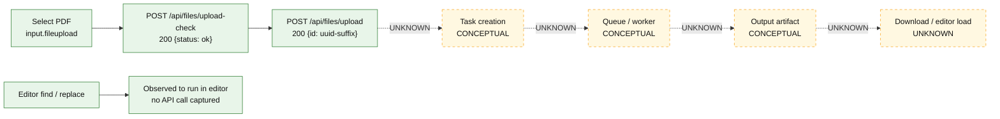

# 13 — File processing and worker architecture

**Phase:** 7 (files/PDF/workers)
**Status:** **COMPLETE for the local client-side pipeline; UPLOAD-ONLY for sejda.com**

## 1. Local `small_editor`: client-side PDF pipeline

**CONFIRMED.** The PDF never leaves the browser tab.

### 1.1 Stages

| Stage | Implementation | Limits/notes |
|---|---|---|
| Input | `<input type=file accept="application/pdf,.pdf">`, drag/drop, sample fetch | extension or MIME check only |
| Read | `File.arrayBuffer()` for user files; `fetch` for sample | no upload |
| Parse | `pdfjs.getDocument({ data, cMapUrl, standardFontDataUrl })` | malformed PDFs reject; toast |
| Worker | `pdf.worker.mjs` via `GlobalWorkerOptions.workerSrc` | pdf.js worker |
| Text extraction | `page.getTextContent()` | depends on embedded text; scanned PDFs have none |
| Line building | `buildLines()` clusters by baseline, inserts gap spaces, starts new line on x jump | rotated/skewed text approximate |
| Find | `findInPage` / `findInDocument` over page models | caps highlights at 1500 |
| Render | `<canvas>` per page at current scale | lazy via `IntersectionObserver` |
| Overlay | absolutely positioned `.hit` boxes | one `.current` |
| Export | text Blob + `<a download>`; clipboard copy | user-initiated |

### 1.2 What is absent locally

- No server upload, storage, queue, worker service, conversion, OCR, or download authorization.
- No background processing beyond the pdf.js worker and lazy rendering.
- No file retention/cleanup (the browser tab owns the bytes).
- No virus scanning, size quota, or tenant isolation.

## 2. Captured sejda.com: upload observed, processing not

### 2.1 Observed pipeline

### 2.2 Observed facts

| Step | Observation | Evidence |
|---|---|---|
| Select file | `input.fileupload`; 3 KB fixture loaded | `art_950ee478…` |
| Pre-check | `POST /api/files/upload-check` → `200 {"status":"ok"}` | `art_47c57f36…` |
| Upload | `POST /api/files/upload?_s=4&uplid=…` → `200 {"id":"<uuid>-<suffix>"}` | `art_47c57f36…` |
| Cookies | no `Set-Cookie`; `clientId`, `_s`, `lang` already present | `art_47c57f36…` |
| Task start | **not observed** | — |
| Job status | **not observed** | — |
| Output/download | **not observed** | — |
| Conversion/OCR | **not observed** | — |
| Worker/queue | **not observed** | — |
| Storage | **not observed** | — |

### 2.3 Client references to a task lifecycle

The shipped bundle contains literals/call sites for:

- `POST /api/files/{id}/password`
- `DELETE /api/tasks/{id}`

This **suggests** a server-side task resource, but the request/response schema, status polling, and execution model are **UNKNOWN**. No task was created or deleted during the probe.

### 2.4 Retention and cleanup

**UNKNOWN.** The upload returned an id but no expiry metadata. No timed observation, response header, or documentation established retention. Do not claim “files are deleted after N hours”; that is not supported.

### 2.5 Security boundaries

- Only a 3 KB test fixture was uploaded; no private documents.
- No conversion task was started; no output was downloaded.
- No authenticated upload, batch upload, or large-file test.
- No malware scanning, rate-limit, or quota behavior was tested.

## 3. Local vs remote processing

| Aspect | Local | Sejda capture |
|---|---|---|
| Where parsing happens | Browser (pdf.js) | Unknown (likely server for tools; editor may be mixed) |
| Upload | none | observed |
| Queue/worker | none | unknown |
| OCR | none | tool exists (`/ocr-pdf`), implementation unknown |
| Conversion | none | tool routes exist, implementation unknown |
| Retention | tab lifetime | unknown |
| Download authorization | none | unknown |
| Limits | browser memory; 1500 highlights | unknown |

## 4. What would establish the remote pipeline

1. Complete an ordinary conversion workflow and capture task status/download requests (with authorization).
2. Observe timing, polling interval, retries, and error states.
3. Inspect backend source/JAR for task/queue/storage classes.
4. Review retention/cleanup jobs or documentation.
5. Test authorized limits (size/type) without abusive load.

## 5. Phase 7 conclusion

The local file pipeline is fully understood and entirely client-side. For sejda.com, only the **upload handshake** is documented; the processing, queue, worker, storage, output, retention, and download stages remain **UNKNOWN**. That is not enough to reconstruct the processing backend.
