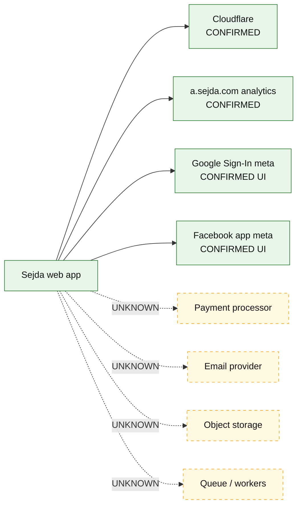

# 14 — Payments and external integrations

**Phase:** 8 (payments/integrations)
**Status:** **N/A for the local prototype; OBSERVED PUBLIC SURFACE ONLY for sejda.com**
**Constraint:** No checkout, charge, refund, subscription change, email send, or production webhook was triggered.

## 1. Local `small_editor`: no payments, no integrations

**CONFIRMED.** The local app has:

- no payment provider, checkout, subscription, billing portal, or webhook
- no email/SMS provider
- no analytics, monitoring, error reporting, CRM, feature flag, or cloud storage
- no external API client
- no secrets or API keys in source

The only network request is the local sample PDF. `npm audit` reports 0 known vulnerabilities in the declared dependency tree.

## 2. Captured sejda.com: pricing is observed, payment flow is not

### 2.1 Rendered plans

| Product | Plan | Price | Term | Notes | Evidence |
|---|---|---|---|---|---|
| Web | Week Pass | $5/user | 7 days | one-time | `art_c5ef10a4…` |
| Web | Monthly | $7.50/user/month | monthly | recurring | `art_c5ef10a4…` |
| Web | Desktop + Web Annual | $63/user/year | yearly | “save 30% over monthly” | `art_c5ef10a4…` |
| Web | Free | $0 | — | “No signup required. Limited usage and features” | `art_c5ef10a4…` |
| Desktop | Desktop Week Pass | $7.95/user | 7 days | Desktop + Web | `art_8316d6c6…` |
| Desktop | Desktop + Web Annual | $63/user/year | yearly | Desktop + Web | `art_8316d6c6…` |
| Desktop | Business | not rendered | — | team section, no price in capture | `art_8316d6c6…` |
| API | 7 tiers | $12/200 … $768/9600 per month | monthly | unlimited document size; self-hosted option | `art_2c04102d…` |

All paid web cards state a **20% volume discount for 10 users**.

### 2.2 What is *not* established

| Question | Status | Why |
|---|---|---|
| Payment processor (Stripe/Paddle/Adyen/other) | **UNKNOWN** | Checkout not opened; no provider script/iframe captured |
| Checkout URL/flow | **UNKNOWN** | Not exercised |
| Billing portal | **UNKNOWN** | Account-gated |
| Subscription lifecycle | **UNKNOWN** | No account |
| Tax/VAT handling | **UNKNOWN** | Not rendered |
| Refund/cancellation policy | **UNKNOWN** | Not exercised |
| Webhooks | **UNKNOWN** | Server-side; not observable |
| Currency handling beyond USD | **UNKNOWN** | Only USD rendered |
| Coupon/discount logic | **UNKNOWN** | Only the 10-user volume claim observed |

**Do not assume Stripe** (or any other processor) from the existence of pricing cards.

### 2.3 Third-party services observed

| Party | Evidence | Status | Role |
|---|---|---|---|
| Cloudflare | `Server: cloudflare`, CF-RAY, challenge script | observed | CDN/WAF/bot management |
| Google | `google-signin-client_id` meta | observed | Sign-In identity |
| Facebook | `fb:app_id` meta | observed | Facebook app identity |
| `a.sejda.com` | `pa-*.js` analytics script; `POST /api/event` → 202 `ok` | observed | First-party analytics |
| Sentry/Raven | `Raven.captureException` in shared bundle | derived | client error reporting |
| Payment provider | none observed | **unknown** | billing |
| Email provider | none observed | **unknown** | transactional email |
| Cloud storage/queue | none observed | **unknown** | file/task processing |

### 2.4 Integration boundary

### 2.5 Privacy/security notes

- Public identifiers (Google client id, Facebook app id) were observed but are **not reproduced** in this dossier.
- No payment data, card data, or personal data was collected.
- No real charge, refund, email, or subscription mutation was performed.
- The pricing pages were logged-out renders; personalized/regional pricing may differ.

## 3. What would establish payments/integrations

1. Authorized checkout in a test/sandbox environment, with network capture.
2. Provider documentation or sanitized configuration.
3. Webhook endpoint code/spec (backend artifact).
4. Account/billing portal behavior with a test account.
5. Email/queue/storage configuration from backend source.

## 4. Phase 8 conclusion

Pricing and several public third-party signals are documented. **No payment provider, checkout flow, webhook, or external processing integration is confirmed.** The local prototype has none at all.
