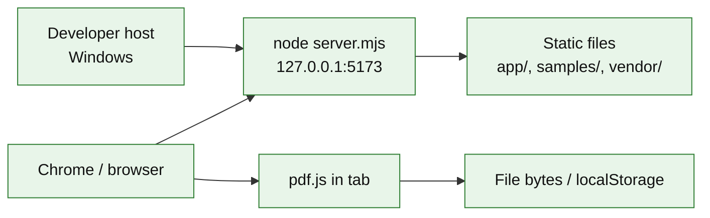
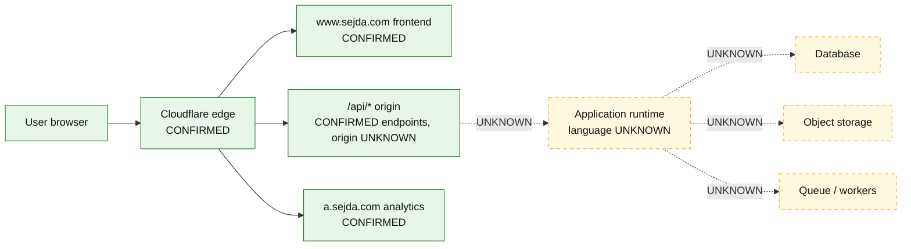
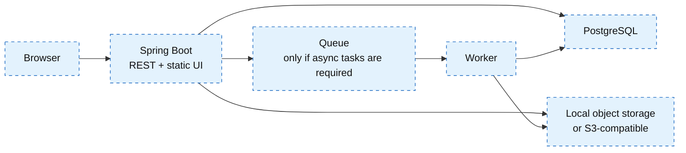

# 15 — Deployment and infrastructure

**Phase:** 9 (deployment/infrastructure)
**Status:** **COMPLETE for the local prototype; PUBLIC EDGE ONLY for sejda.com**
**Constraint:** No private infrastructure was accessed or inferred from a domain name alone.

## 1. Local `small_editor`

### 1.1 Confirmed deployment



| Item | Value |
|---|---|
| Runtime | Node.js 26.12.1 |
| Server | `server.mjs`, zero dependencies |
| Bind | `127.0.0.1:5173` by default (`PORT`, `HOST` env overrides) |
| TLS | none (plain HTTP on loopback) |
| Reverse proxy/CDN | none |
| Database | none |
| Queue/cache/object storage | none |
| Container | none |
| CI/CD | none |
| Health check | none |
| Logs | stdout only (`Small Editor → http://…`) |
| Persistence | browser `localStorage` + files on disk |

### 1.2 Response headers

Observed for `GET /app/`:

```http
HTTP/1.1 200 OK
Content-Type: text/html; charset=utf-8
Content-Length: 6990
Cache-Control: no-store
```

File responses additionally set:

- `X-Content-Type-Options: nosniff`
- `Cross-Origin-Opener-Policy: same-origin`

Missing: `Content-Security-Policy`, `X-Frame-Options`, `Referrer-Policy`, `Permissions-Policy`, HSTS (HTTP only). See `16-security-and-quality-review.md`.

### 1.3 Operational characteristics

- Single process, no clustering, no graceful shutdown handler.
- Synchronous `statSync` per request; fine for local use.
- No request timeout/body limits (no request bodies are accepted).
- No access log, metrics, or tracing.
- No backup/recovery (stateless static files).

## 2. Captured sejda.com: edge only

### 2.1 Confirmed

| Layer | Observation | Evidence |
|---|---|---|
| Edge | `Server: cloudflare`; `CF-RAY`; `cf-cache-status: DYNAMIC` | `art_d2e5a61d…`, `art_47c57f36…` |
| WAF/bot check | Cloudflare challenge script in page | `art_d3ea633b…` |
| Plain curl | `403` Cloudflare block page | `art_27c8ec96…`, `art_1d03506c…` |
| Origin | **not identified** | — |
| Frontend delivery | static HTML/CSS/JS from `www.sejda.com` | `art_d3ea633b…` |
| Analytics origin | `a.sejda.com` | `art_d3ea633b…` |
| API | same-origin `/api/...` behind Cloudflare | `art_47c57f36…` |
| Cache | HTML/API `DYNAMIC`; static assets likely cached (not fully measured) | headers |
| TLS | HTTPS; `alt-svc: h3` observed | `art_d2e5a61d…` |

### 2.2 Not established

- Hosting provider/region, origin server OS, JVM/container orchestration.
- Load balancer, reverse proxy, service mesh.
- Database, object storage, queue, cache.
- CDN cache rules, purge strategy, WAF rules.
- Autoscaling, health checks, blue/green or canary deployment.
- CI/CD, artifact registry, secrets management.
- Backup/recovery, RPO/RTO.
- Observability (logs/metrics/traces) beyond Cloudflare NEL/report-to hints.
- Whether frontend and backend are separate deployments.

**Do not infer private infrastructure from `Server: cloudflare`.** It only proves an edge.

### 2.3 Deployment diagram



## 3. Proposed deployment for an independent implementation (NOT observed)

If a Java reconstruction is approved, a minimal local-first deployment could be:



This is a **design proposal**, not evidence about Sejda. The queue/worker is optional; the observed contract only proves upload, not asynchronous processing.

## 4. What would establish the real infrastructure

1. Authorized architecture documentation.
2. Backend deployment manifests (Dockerfile, Helm, Compose, Terraform).
3. Sanitized environment/config.
4. Authorized logs/metrics/traces.
5. Cloud provider account inventory (only with explicit authorization).
6. DNS/TLS certificate transparency for public endpoints (limited value; not private infra).

## 5. Phase 9 conclusion

The local prototype is a single Node process serving static files on loopback. Sejda is **confirmed** to sit behind Cloudflare with a public frontend and `/api/` endpoints; everything behind the edge is **UNKNOWN**. No statement about Java, databases, queues, or hosting can be made from the edge headers.
