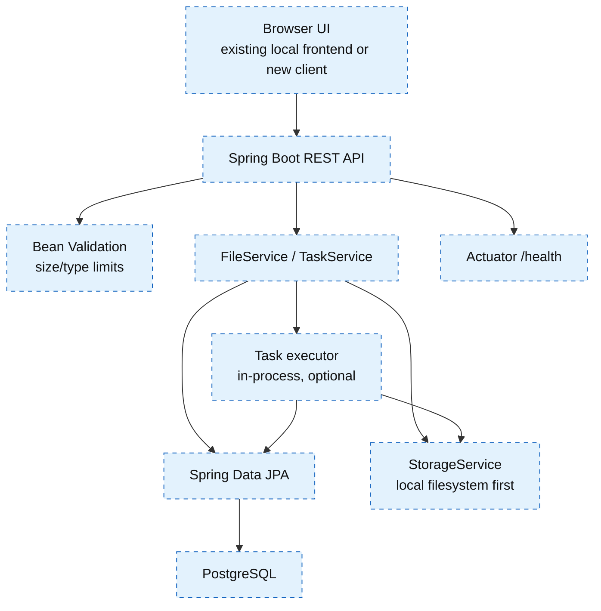

# 17 — Reconstruction proposal

**Phase:** 11 (reconstruction)
**Status:** **PROPOSAL ONLY — no code created**
**Approval required before creating any backend directory, build file, or dependency.**

## 1. Two separate goals

### Goal A — Original source recovery

**Status: NOT POSSIBLE with the current artifacts.**

Recovery requires at least one of:

- backend source repository/archive
- JAR/WAR/EAR
- container image
- database migrations
- build files (`pom.xml`, `build.gradle`)
- authorized server logs/error traces

None exists in `D:\small_editor`. Therefore there is **no recovered original backend** and no claim of one.

### Goal B — Independent implementation

**Status: PROPOSED.** A new Java/Spring Boot service that reproduces the *documented* public behaviour. It is not the vendor's code and will be labelled as an independent implementation everywhere.

The existing local frontend already implements the search surfaces and client-side PDF reading. The backend proposal is for the **server-side upload/task contract**, if that is the desired scope.

## 2. What is confirmed vs assumed

| Requirement | Status | Basis |
|---|---|---|
| Public JSON upload check | **CONFIRMED** | `POST /api/files/upload-check` → `{"status":"ok"}` |
| Public multipart upload | **CONFIRMED** | `POST /api/files/upload` → `{"id":"<uuid>-<suffix>"}` |
| Same-origin API behind an edge | **CONFIRMED** | `Server: cloudflare`, same-origin calls |
| Anonymous upload (logged out) | **CONFIRMED** | 3 KB fixture accepted |
| Task resource | **CLIENT REFERENCE ONLY** | `DELETE /api/tasks/{id}` literal; not exercised |
| Password-protected file | **CLIENT REFERENCE ONLY** | `POST /api/files/{id}/password` literal; not exercised |
| Authentication/authorization | **UNKNOWN** | Not exercised |
| Database engine/schema | **UNKNOWN** | No schema/migration |
| Asynchronous queue/worker | **UNKNOWN** | No task lifecycle observed |
| Storage backend/retention | **UNKNOWN** | No metadata |
| Payment/billing | **UNKNOWN** | No checkout |
| Search endpoint | **NONE OBSERVED** | Tool search is client-side |
| Java/Spring Boot | **UNKNOWN for the Sejda web backend** | The public Sejda **SDK/PDF engine** is confirmed Java; this proposal is still a chosen implementation, not recovered web source |

## 3. Proposed minimal architecture (independent)



### 3.1 Deliberately minimal stack

| Layer | Choice | Why |
|---|---|---|
| Language | **Java 21 LTS** | Supported LTS; local JDK 23 can target 21 |
| Framework | **Spring Boot 3.x** | Standard Java REST stack; matches the requested direction |
| Web | Spring Web (MVC) | Simple JSON/multipart endpoints |
| Validation | Jakarta Bean Validation | Size/type checks |
| Persistence | Spring Data JPA + **PostgreSQL** | Files/tasks metadata |
| Migrations | **Flyway** | Versioned schema |
| API docs | springdoc-openapi | Generated OpenAPI for the reconstructed service |
| Storage | Local filesystem behind an interface | No cloud credentials assumed; S3 adapter later |
| Async | In-process executor behind an interface | Only if task semantics are approved; queue later |
| Auth | **Deferred / configurable** | Observed anonymous upload; do not invent an auth model |
| Observability | Actuator health + structured logs | Minimal operational baseline |
| Tests | JUnit 5, MockMvc, repository tests, Testcontainers (optional) | Contract + persistence confidence |
| Packaging | Dockerfile + Compose (app + Postgres) | Reproducible local run |

**Not included initially:** payments, email, OCR, PDF conversion engines, cloud queue, multi-tenancy, SSO. Those are unobserved or out of scope; adding them would be speculation.

### 3.2 Why Java 21 and not Java 23

- Java 21 is an LTS target with broad Spring Boot support.
- The local JDK 23 can compile with `--release 21`.
- The vendor's Java version is **unknown**; this is an implementation choice, not a recovered fact.

## 4. Proposed directory layout

```
reconstructed-backend/                 # new, separate; never overwrites the local app
  pom.xml
  mvnw / mvnw.cmd / .mvn/              # optional wrapper (downloads Maven)
  src/main/java/com/example/smalleditor/
    SmallEditorBackendApplication.java
    api/
      FileController.java
      TaskController.java
      ApiExceptionHandler.java
    domain/
      UploadedFile.java
      ProcessingTask.java
      TaskStatus.java
    repo/
      UploadedFileRepository.java
      ProcessingTaskRepository.java
    service/
      FileService.java
      TaskService.java
      StorageService.java
      LocalStorageService.java
    config/
      WebConfig.java
      LimitsConfig.java
  src/main/resources/
    application.yml                    # no secrets; env placeholders
    db/migration/V1__files_and_tasks.sql
  src/test/java/...
  Dockerfile
  compose.yaml
  .env.example                         # placeholders only
  README.md
  openapi.yaml                         # generated/exported
```

## 5. Proposed API for the independent service

Only the two observed operations are implemented as confirmed behavior. The other two are **501 Not Implemented** until their contracts are specified.

| Method | Path | Behavior | Status |
|---|---|---|---|
| POST | `/api/files/upload-check` | Validate presence/type/size; return `{"status":"ok"}` | parity with observed |
| POST | `/api/files/upload` | Store file; return opaque id; 201 or 200? | observed 200; follow 200 for parity |
| POST | `/api/files/{id}/password` | Return `501` with a clear message | client reference only |
| DELETE | `/api/tasks/{id}` | Return `501` (or implement if task model approved) | client reference only |
| GET | `/actuator/health` | `{"status":"UP"}` | operational |

### 5.1 Deliberate contract decisions

- Return `200 OK` on successful upload to match the observation, not `201`.
- Return `application/json;charset=utf-8`.
- Use an opaque id shaped `<uuid>-<suffix>` to match the observed format, but document that the suffix is implementation-specific.
- Do **not** set a session cookie on upload (observed: no `Set-Cookie`).
- Enforce configurable max upload size and allowed content types; return a documented JSON error. The vendor's exact limits are unknown, so they are **assumptions**, not parity.
- CORS: same-origin by default; no wildcard.
- No authentication in the first cut because the observed surface is anonymous. This is a **security assumption**, not a claim about Sejda; expose only on loopback or behind a trusted gateway.

### 5.2 Error format (reconstructed)

```json
{
  "error": "unsupported_media_type",
  "message": "Only application/pdf is accepted",
  "requestId": "..."
}
```

This is a **new design**, not the vendor's error schema (which was not observed).

## 6. Proposed data model

See `11-database-and-data-model.md` for the conceptual ER diagram. The first migration would create:

- `uploaded_file` — id, storage_key, original_name, content_type, size_bytes, sha256, created_at, expires_at (nullable)
- `processing_task` — id, file_id, type, status, options_json, created_at, started_at, finished_at, error_code, error_message
- indexes on `processing_task(file_id)`, `processing_task(status)`, `uploaded_file(expires_at)`

**All of this is proposed.** No production table/column name was observed.

## 7. Proposed security design

| Control | Proposal |
|---|---|
| Upload size | Configurable max (e.g. 25 MB default; assumption) |
| Content type | Allow `application/pdf`; verify magic bytes (`%PDF-`) |
| Filename | Never use client filename as a path; generate storage key |
| Storage | Outside the web root; no direct static serving |
| Path traversal | Canonicalize and verify storage root |
| Auth | Deferred; if enabled, Spring Security with explicit rules |
| Rate limiting | Deferred; add at gateway or Bucket4j if needed |
| Malware scanning | Out of scope initially; document |
| Retention | Scheduled cleanup by `expires_at` (proposed TTL) |
| Logging | Structured; no file contents or secrets |
| CORS/CSRF | Same-origin; CSRF only if cookie auth is introduced |
| Error handling | No stack traces to clients |

## 8. Proposed tests

| Test | What it proves |
|---|---|
| `uploadCheck_acceptsPdf` | `200 {"status":"ok"}` |
| `uploadCheck_rejectsMissingFile` | 400 + error body |
| `upload_storesAndReturnsId` | 200 + opaque id |
| `upload_rejectsOversize` | 413/400 (choose and document) |
| `upload_rejectsNonPdf` | 415 |
| `taskDelete_unknownId` | 404/501 as documented |
| `storage_pathTraversalRejected` | no escape |
| `repository_migration` | Flyway + JPA mapping |
| `health` | Actuator UP |

Browser-level tests would be added only if a UI is built for the backend; the existing local UI does not call it.

## 9. Tooling and installation implications

| Need | Current state | Action if approved |
|---|---|---|
| Maven | not installed | install Maven **or** use Maven Wrapper (downloads on first run) |
| Spring Boot deps | none | Maven resolves from Central; disk/network cost |
| PostgreSQL | not installed/verified | Docker Compose (Docker daemon currently not running) or local install |
| Docker | CLI installed, daemon not running | start Docker Desktop for Compose |
| Tests | JUnit not present | Maven test dependencies |

**PoC update:** to avoid a Maven/Spring installation, the approved PoC uses the JDK HTTP server plus three vendored Apache PDFBox jars. No application source, configuration, sample, or existing test was modified. The production tooling table above remains relevant only if a Spring Boot production cut is chosen.

## 10. Approval gate

**Resolved for the PoC on 2026-10-25:**

1. **Scope:** upload/task backend only; no new frontend.
2. **Auth:** anonymous and local-only; no accounts or API keys.
3. **Async:** in-process task executor; no durable queue/worker.
4. **Database:** none; in-memory metadata plus private temp files.
5. **Location:** `D:\small_editor\reconstructed-backend\`, isolated from the app.
6. **Java version:** Java 17 source level; tested on OpenJDK 23.0.1. Production should prefer 21 LTS.
7. **PDF engine/licensing:** Apache PDFBox 2.0.32 (Apache-2.0); the Sejda SDK (AGPLv3/commercial) is not used.

**Production decisions still open:** Spring Boot versus a smaller server, PostgreSQL/object storage, durable queue, auth/tenancy, signed URLs, retention, rate limiting, and whether to adopt the Sejda SDK under AGPLv3 or a commercial PRO license. The production first cut remains **Java 21 + Spring Boot + H2 tests + PostgreSQL via Compose + upload/task skeleton**, with no auth, payment, OCR, or Office conversion.

## 11. What will *not* be claimed

- That this is the original Sejda backend.
- That Sejda uses Java for its **web backend**, Spring Boot, PostgreSQL, Flyway, or any of these choices.
- That the public Java SDK is the exact engine used by sejda.com, or that its AGPLv3/commercial terms fit this proposal.
- That the reconstructed limits, error schema, task model, or retention match production.
- That the public client is the complete application.

## 12. Phase 11 conclusion

**Original source recovery: unavailable.** **Independent reconstruction: approved and PoC created.** See `21-backend-poc.md` and `../reconstructed-backend/`. The PoC uses Apache PDFBox, not the Sejda SDK.
