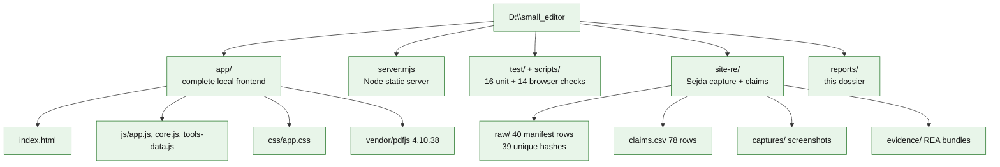
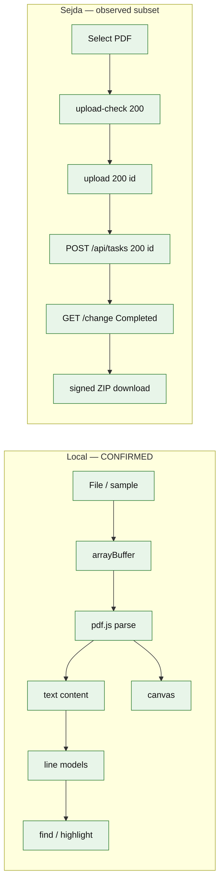

# 18 — Final application dossier

**Investigation:** `D:\small_editor`, 2026-10-24 UTC
**Phases:** 0–12, with Phase 4B blocked for the web backend; external SDK review, 44-tool matrix, and seven observed public task types completed; independent backend PoC verified with 9 bounded task types
**Bottom line:** **No Sejda web-backend artifact exists in the workspace.** The official Sejda **SDK/PDF engine is Java** (confirmed), but the **sejda.com web backend** was not obtained and remains **unverified**. The local prototype’s only backend is a **Node.js static server**; an independent Java PoC now exists separately in `reconstructed-backend/`. No original Sejda **web backend** source can be recovered from the available artifacts.

---

## 1. Executive summary

The investigation covers two in-workspace artifacts plus one external follow-up:

1. **`D:\small_editor`** — a complete, independently written **local-first PDF reader**. Frontend: vanilla ES modules + pdf.js 4.10.38. Backend: a zero-dependency **Node.js** static server (`server.mjs`). It implements Sejda-style tool search and occurrence-level document find. 16/16 unit tests and 14/14 browser checks pass. It has **no upload API, no database, no auth, no payments, no Java**.
2. **`site-re/sites/sejda-com/`** — a **partial public-frontend capture** of sejda.com: 40 manifest rows / 39 unique hashes, **78 claims (56 observed, 15 derived, 7 unknown)**, the original 5 REA records plus 9 bounded-pass records. Separate static-matrix and workflow manifests list the 44-tool and seven-task-type artifacts. It documents the All Tools filter, the editor Find & Replace behavior, 44 tool routes, 52 English sitemap routes, 55 known unique routes, 28 locales, and a public upload/task API. It contains **no server source, JAR, WAR, database schema, or configuration**.

The user-reported claim “the backend is Java” is now **partially confirmed**: the official `torakiki/sejda` repository is a **Java PDF SDK/engine** (583 Java files, 9 Maven modules, Java 17, AGPLv3). But that repository contains **no web/API/auth/data layer**, so it does not prove the **sejda.com web backend** is Java. Public web evidence remains compatible with Java but also with several other stacks. There is no `JSESSIONID`, Spring/Tomcat/Jetty banner, framework error page, or web-backend artifact.

**No original Sejda web-backend source was recovered.** The SDK source is public and was reviewed externally. An independent Java backend PoC now exists in `reconstructed-backend/`; it uses Apache PDFBox and the JDK HTTP server, not the Sejda SDK.

---

## 2. Exact investigation scope

| In scope | Out of scope |
|---|---|
| All files under `D:\small_editor` | Unrelated personal directories |
| Local app source, tests, server, package manifest | Private server files |
| Captured sejda.com public HTML/JS/CSS/screenshots/probes | Login-gated account area |
| Public, logged-out, ordinary workflows | Checkout, payments, subscription changes |
| One 3 KB fixture upload | Private documents, bulk uploads, destructive tests |
| Read-only headers/404/API probes | Auth bypass, privilege escalation, exploitation |
| REA browser/JS evidence | Native binary analysis without an artifact |

**Environment:** Windows 10.0.26300 x64, Node 26.12.1, Python 3.11.9, OpenJDK 23.0.1, Docker 29.8.2 (daemon not running), no Maven/Gradle, no Git repository.

---

## 3. Workspace inventory



| Item | Count / value |
|---|---|
| Local source files (hand-written) | 6 main files + server + tests/scripts |
| Local runtime dependencies | 1 (`pdfjs-dist`; vendored) |
| Local dev dependencies | 1 (`pdf-lib`, fixture only) |
| Local API endpoints | 0 |
| Local database tables | 0 |
| Sejda web-backend Java artifacts in workspace | **0**; independent PoC: 5 Java source files + 3 Apache PDFBox jars |
| External official Sejda SDK | **583 Java files / 9 Maven modules** (reviewed at `98712cd`; not vendored) |
| Sejda captured artifacts | 40 manifest rows / 39 unique hashes |
| Sejda claims | 78 (56 observed, 15 derived, 7 unknown) |
| Sejda tools | 44 unique routes / 43 task pages / 41 unique `data-task` values |
| Sejda English routes | 52 sitemap / 55 known unique |
| Sejda locales | 28 |
| REA records used | 5 original + 9 bounded-pass (tool pages, bundle analysis, targets) |

---

## 4. Confirmed technology stack

| Layer | Local `small_editor` | Captured sejda.com |
|---|---|---|
| Frontend | Vanilla ES modules, HTML, CSS | Minified/obfuscated production HTML/JS/CSS; framework not established |
| PDF engine | pdf.js 4.10.38 | **Official Java SDK for PDF tasks — CONFIRMED**; web-service wrapper unknown |
| Server | **Node.js 26.12.1**, `node:http`, no framework | **Unknown**; origin behind Cloudflare |
| API | none | JSON upload endpoints |
| Database | none | Unknown |
| Auth | none | Login UI observed; model unknown |
| Queue/workers | none (pdf.js worker only) | Unknown |
| Payments | none | Pricing observed; provider unknown |
| Hosting | loopback static server | Cloudflare edge |
| Java | **not present** | **SDK/engine: Java (CONFIRMED); web backend: unverified** |

---

## 5. Frontend architecture

### 5.1 Local

- Single page, no router, no framework.
- `app.js` is the controller; `core.js` is pure logic; `tools-data.js` is the 20-command catalog.
- `pdf.js` parses in the tab; canvas rendering + absolutely positioned highlight overlay.
- State: in-memory document + `localStorage` for pins/recents/theme/dim.
- No network after load except the local sample fetch.

Detailed: `02-frontend-architecture.md`, `03-page-and-component-inventory.md`, `04-ui-interaction-catalog.md`, `05-frontend-dependencies-and-build.md`.

### 5.2 Sejda capture

- Marketing pages are server-rendered; editor bundle is obfuscated.
- Shared bundle contains the exact tool-filter handler; no source maps found.
- Editor Find & Replace behavior was runtime-observed only.
- The `#searchTools` input is `display:none` in the captured render; the reason is unknown.

---

## 6. Complete page/component catalog

| Target | Catalog |
|---|---|
| Local | 1 page; topbar, dropzone, viewer, find bar, tool palette, toast, info dialog; 20 commands |
| Sejda | 52 English routes; 44 tool routes in 11 groups; pricing/desktop/API/workflows/help/teachers/login pages; mega-menu, tool search, recents/pins, editor find modal, upload input |

The full 44-route table is in `03-page-and-component-inventory.md` and `site-re/sites/sejda-com/inventory.md`.

---

## 7. API inventory and contracts

| Target | API |
|---|---|
| Local | **None.** Static GET/HEAD only; `/` → `/app/`; 404/403/405. |
| Sejda | `POST /api/files/upload-check` → `{"status":"ok"}`; `POST /api/files/upload` → `{"id":"<uuid>-<suffix>_<counter>"}`; `POST /api/tasks` → `"<task-id>"`; `GET /api/tasks/{id}/change` → `Completed` + result metadata; signed ZIP download; analytics `POST a.sejda.com/api/event` → 202 `ok`; client references password/touch/cancel/delete/chunked/cloud-import. |

The upload and seven observed task lifecycles now have enough evidence for the reconstructed OpenAPI contract (`07-api-contracts.yaml`, v0.4.0). Error/validation behavior, 34 task types and most client-only paths remain unknown (`08-api-error-and-validation-catalog.md`). Full bounded-pass detail: `20-bounded-rea-pass.md`; matrix and workflows: `22-tool-matrix-and-workflows.md`.

---

## 8. Backend language and artifact inventory

**CONFIRMED:** local backend is Node.js, by source.

**CONFIRMED:** no Java **web-backend** artifact exists in the workspace. Search patterns and zero-result record: `reports/_raw/java-artifact-search.txt`.

**CONFIRMED:** the official Sejda SDK/PDF engine is Java — 583 Java files, 9 Maven modules, Java 17, AGPLv3, reviewed at commit `98712cd`. It is a **library**, not the sejda.com web backend: no Spring/servlet/controllers, no HTTP endpoints, no `main`, no DB/auth/queue code.

**UNKNOWN:** sejda.com **web backend** language/framework. No Java-specific fingerprint; Cloudflare strips/normalizes headers; custom 404; no `JSESSIONID`.

Detailed: `09-backend-language-and-artifact-inventory.md`; SDK review: `19-official-sejda-sdk-review.md`.

---

## 9. Java analysis results

**SDK source review: COMPLETE. Web backend: BLOCKED.**

- The official `torakiki/sejda` SDK was shallow-cloned and source-reviewed: 583 Java files, 9 Maven modules, Java 17, AGPLv3. No code was executed.
- The SDK contains no web/API module, Spring/servlet/controller, HTTP endpoint, `main`, database/auth/queue code, or the observed sejda.com `/api/files/*` routes.
- No Sejda **web backend** `.java`, `.class`, `.jar`, `.war`, `.ear`, `pom.xml`, Gradle file, Spring config, JPA mapping, migration, or JVM log exists in the workspace.
- No decompilation was performed. `javap`/`jar` are available with JDK 23; Maven/Gradle are not installed; CFR/Vineflower are not installed; REA JEB provider is not configured.
- Tool installation cannot substitute for a missing web-backend artifact.

Detailed: `10-java-source-and-bytecode-analysis.md`, `19-official-sejda-sdk-review.md`.

---

## 10. Database and data model

| Target | Finding |
|---|---|
| Local | **No database.** In-memory PDF state + `localStorage` keys. |
| Sejda | **No actual schema.** Engine/ORM/tables unknown. The ER diagram in `11-database-and-data-model.md` is a **conceptual hypothesis** derived from opaque file/task ids, not production design. |

---

## 11. Authentication and authorization

| Target | Finding |
|---|---|
| Local | **None.** No accounts, cookies, sessions, JWT, OAuth, CSRF, or authz. |
| Sejda | Logged-out UI observed (Google Sign-In + email/password); anonymous upload accepted; cookies `clientId`, `_s`, `lang`; no `JSESSIONID`; authz/ownership/CSRF/rate-limit **unknown**. |

No login, bypass, or privilege escalation was attempted. Detailed: `12-authentication-and-authorization.md`.

---

## 12. File-processing pipeline



Local processing is entirely client-side. Sejda: the public upload → task submit → status poll → signed download flow is documented. The queue/worker/storage/retention internals remain **unknown**. Detailed: `13-file-processing-and-worker-architecture.md` and `20-bounded-rea-pass.md`.

---

## 13. Payments and external services

- **Local:** none.
- **Sejda:** pricing observed (3 web plans, 2 desktop plans, 7 API tiers, 20% 10-user discount); payment provider/checkout/webhooks **unknown**. Observed third parties: Cloudflare, Google Sign-In meta, Facebook app meta, first-party analytics `a.sejda.com`; Sentry/Raven reference derived from bundle. No charge or email was triggered.
- **Do not assume Stripe.** Detailed: `14-payments-and-external-integrations.md`.

---

## 14. Deployment and infrastructure

| Target | Finding |
|---|---|
| Local | Single Node process, `127.0.0.1:5173`, static files, no TLS/DB/queue/container/CI. |
| Sejda | Cloudflare edge confirmed; origin/hosting/runtime/database/queue **unknown**. |

Detailed: `15-deployment-and-infrastructure.md`.

---

## 15. Security and quality findings

### Local

| ID | Severity | Finding | Confidence |
|---|---|---|---|
| F-01 | **Medium** | `GET /%` crashes `server.mjs` (`decodeURIComponent` uncaught); verified on temp port 5199 | CONFIRMED |
| F-02 | Low | Missing CSP / frame-ancestors / Referrer-Policy / Permissions-Policy; directory response lacks nosniff/COOP | CONFIRMED |
| F-03 | Low | Static server follows symlinks; possible escape if a symlink is planted in root | POSSIBLE |
| F-04 | Info/High if exposed | No auth by design; default loopback is the only control | CONFIRMED |
| F-05 | Info | `innerHTML` only for static content; no user-data XSS sink found | CONFIRMED |
| F-06 | Low | PDFs parsed client-side by pdf.js 4.10.38; keep updated | CONFIRMED |
| F-07 | Info | No request-body handling | CONFIRMED |
| F-08 | Info | 0 audit vulns, 16/16 unit, 14/14 browser; no CI/lint/coverage | CONFIRMED |

### Sejda (observations, not vulnerabilities)

- Anonymous 3 KB upload accepted.
- Cookies non-HttpOnly/`Secure=false` in capture; production context unknown.
- No `Set-Cookie` on upload.
- No Java/framework fingerprint.
- Cloudflare 403 to curl; not bypassed.
- No remote exploitation.

Detailed: `16-security-and-quality-review.md`.

---

## 16. Test coverage

| Suite | Result | Evidence |
|---|---|---|
| `npm test` | **16/16 pass** | command output in session |
| `node scripts/browser-check.mjs` | **14/14 pass** | `reports/_raw/browser-check.txt` |
| `npm audit` | **0 vulnerabilities** (declared tree) | `reports/_raw/npm-audit.json` |
| Sejda tests | none available | — |

The browser check covers sample load, occurrence counting (9), highlight painting, current marker, cross-page matches, wrap, case, whole word/phrase, palette dimming (20 rows / 17 dim / 0.1), first-result scroll, pinning, Escape order, and console errors.

---

## 17. Missing evidence

| Priority | Missing item | Unlocks |
|---|---|---|
| P0 | Sejda **web backend** source/archive | Full web/API/auth/data traceability. SDK source is public and already reviewed. |
| P0 | Sejda **web application** JAR/WAR/EAR | Bytecode/decompilation of the HTTP layer |
| P1 | Docker image | Runtime/config/dependencies |
| P1 | DB schema/migrations | Actual data model |
| P1 | Sanitized `application.yml`/Security config | Framework/auth/storage |
| P2 | Authorized logs/error traces | Runtime fingerprint |
| P2 | API spec/integration tests | Exact contracts |
| P2 | Account session | Auth/authz/task lifecycle |
| P3 | Checkout sandbox | Payment provider/flow |
| P3 | Retention docs/observation | File lifetime |

---

## 18. Confidence ratings

| Conclusion | Rating |
|---|---|
| Local app is complete source and Node-backed | **CONFIRMED** |
| Local app has no upload/API/DB/auth | **CONFIRMED** |
| No Sejda Java **web-backend** artifact in workspace (Phase 4 inventory) | **CONFIRMED** |
| Sejda frontend is partial, minified/obfuscated | **CONFIRMED** |
| Sejda tool search is class-dim, no network | **CONFIRMED** (source + runtime) |
| Sejda editor find is line-level | **CONFIRMED** (runtime) |
| Sejda upload/task lifecycle and response shapes | **CONFIRMED** (7 task types: split, split-by-bookmarks, merge, alternate-mix, header/footer, PDF-to-JPG, encrypt) |
| Sejda SDK/PDF engine is Java | **CONFIRMED** |
| sejda.com web backend is Java | **UNKNOWN / unverified** |
| sejda.com web tools use the SDK or its PRO variant | **STRONGLY INFERRED** |
| Sejda DB/queue/storage/auth/payment internals | **UNKNOWN**; public task lifecycle observed |
| Local server malformed-URI crash | **CONFIRMED** |
| Symlink escape | **POSSIBLE** |

---

## 19. Original source recovery status

| Asset | Status |
|---|---|
| Local frontend source | Available (not “recovered”; it is the authored source) |
| Local Node server source | Available |
| Sejda frontend source maps | **Unavailable** (none found) |
| Sejda frontend original source | **Not recovered**; only minified/obfuscated bundles |
| Sejda **web backend** source | **Unavailable** |
| Sejda **web backend** Java bytecode | **Unavailable**; the SDK source is public and was reviewed |
| Sejda database schema | **Unavailable** |

**No original Sejda source code was recovered.**

---

## 20. Independent reconstruction status

**Independent PoC verified in `reconstructed-backend/`; no Sejda SDK used.** It implements 9 bounded task types (6 observed end-to-end, 3 inferred from static forms); the publicly observed `encrypt` task is outside the bounded PoC. See `17-reconstruction-proposal.md`, `21-backend-poc.md`, and `22-tool-matrix-and-workflows.md`.

Production first cut (not this PoC): Java 21 + Spring Boot 3.x + H2 tests + PostgreSQL via Compose + upload/task skeleton, no auth, no payment, no OCR/conversion. The verified PoC uses the JDK HTTP server and Apache PDFBox to avoid Maven and AGPL entanglement; production should decide between Spring Boot + PDFBox and the Sejda SDK under AGPLv3 or a commercial PRO license.

If the official SDK is used for PDF tasks, treat licensing as a first-class decision: AGPLv3 (network copyleft) or the commercial SDK PRO. The open-source task set is a subset of the 44-tool web UI. The PoC deliberately does **not** embed the Sejda SDK; Apache PDFBox 2.0.x is Apache-2.0 licensed.

**Approval status:** the independent PoC is approved and created. Production scope, auth, async, database, location, Java version, and SDK licensing remain decisions.

---

## 21. Recommended next actions

1. **Decide the target**: the local prototype or sejda.com? They are different applications.
2. **If sejda.com web-backend verification is required:** supply a legitimate **web/API** repo or JAR/WAR/image; the public SDK is already reviewed and does not contain that layer. Then run `jar tf`/`javap`/CFR/Vineflower in an isolated directory.
3. **Independent backend:** the approved PoC is in `reconstructed-backend/` (Java + Apache PDFBox, no Sejda SDK). For production, decide between Spring Boot + PDFBox and the Sejda SDK under AGPLv3 or a commercial license.
4. **Harden the local server:** fix F-01, add F-02 headers, resolve symlinks (F-03).
5. **If Sejda claims must be evidence-based:** say “the SDK/engine is Java” (confirmed); do not say “the sejda.com web backend is Java” until a web-layer artifact or fingerprint is obtained.
6. **Optional:** add CI for tests + audit; track pdf.js updates.

---

## 22. Exact commands used

```bash
# Environment
cd D:/small_editor
node --version; npm --version; java -version; javac -version
mvn -v; gradle -v; docker --version; git --version; opencode --version
npx -y rea-agents@latest doctor

# Java/backend artifact search
find . -type f \( -iname '*.java' -o -iname 'pom.xml' -o -iname 'build.gradle*' \
  -o -iname 'settings.gradle*' -o -iname '*.jar' -o -iname '*.war' -o -iname '*.ear' \
  -o -iname 'application.properties' -o -iname 'application.yml' -o -iname 'application.yaml' \
  -o -iname 'Dockerfile' -o -iname 'docker-compose.*' \) \
  -not -path './reports/*' -not -path './site-re/evidence/*'

# Tests
npm test
node scripts/browser-check.mjs
npm audit --json

# Local headers
curl -s -D - -o /dev/null http://127.0.0.1:5173/app/

# Safe malformed-URI test (temporary port)
PORT=5199 node server.mjs &
curl -s -o /dev/null -w '%{http_code}' --path-as-is 'http://127.0.0.1:5199/%'

# REA (through MCP)
# list_browser_targets(cdp_endpoint="http://127.0.0.1:9333",
#   allowed_origins=["https://www.sejda.com"])
# analyze_javascript_application(input_path="D:/small_editor/app", format="directory")
# export_evidence_bundle(path="D:/small_editor/reports/evidence/rea-session.bundle.json")

# External official SDK review (isolated temp clone; no code executed)
git clone --depth 1 https://github.com/torakiki/sejda.git
git -C sejda rev-parse HEAD
git -C sejda ls-files '*.java' | wc -l
rg -l -F 'org.springframework' --glob '*.java' sejda
rg -l -F 'upload-check' --glob '*.java' sejda
cat sejda/sejda-core/src/main/resources/sejda.default.xml
```

---

## 23. Tool installation and configuration changes

**None.** No packages, engines, Maven/Gradle, or browser extensions were installed. No `rea setup` was run. No application code or configuration was modified.

REA doctor reports a stale skill identity and stale client registrations; these were **not** changed because doing so writes configuration and requires approval/restart. The MCP tools remained callable.

---

## 24. Known limitations and unresolved questions

1. **No sejda.com web-backend artifact** — the central limitation; Phase 4B is blocked for the web layer. The SDK source has been reviewed.
2. **Sejda frontend is partial** — no source maps, editor bundle obfuscated; editor find algorithm unknown.
3. **`#searchTools` hidden** — reason unknown (experiment/geo/flag/regression).
4. **Editor empty/regex query hang** — 120 s unresponsive; cause unknown.
5. **Include links** — no link annotations in fixture; effect unknown.
6. **Auth/payments/retention** — not exercised.
7. **REA capture completeness** — scenario captures report `incomplete` (missing events); they support actions, not full causality.
8. **JS graph** — inert parse, includes vendored pdf.js, 0 modules; not a runtime call graph.
9. **Java claim** — split: the SDK/PDF engine is **confirmed Java**; the sejda.com web backend remains **unverified**.
10. **Local server security** — F-01/F-02/F-03 remain unfixed by design (no code changes without approval).

---

## 25. Final verdict

| Mission question | Answer |
|---|---|
| Complete frontend? | **Local: yes. Sejda: no** (partial capture only). |
| Complete web backend? | **No original Sejda backend; only an independent PoC.** |
| Backend language? | **Local: Node.js (confirmed). Sejda web backend: unknown. Sejda SDK/PDF engine: Java (confirmed).** |
| Java backend? | **No Sejda Java web backend. The official SDK/engine is Java; the sejda.com web backend is unverified. An independent Java PoC with 9 bounded task types exists in `reconstructed-backend/`.** |
| Recover original Java source? | **Sejda web backend: no — unavailable. Sejda SDK: public source, reviewed.** |
| Build equivalent? | **Yes, as an independent implementation. A verified PoC covers 9 bounded task types (6 observed, 3 inferred); the observed `encrypt` task is outside that PoC. Full 44-tool parity is P2. SDK use requires an AGPLv3/PRO licensing decision.** |

**The evidence supports saying: “Sejda's PDF SDK/engine is Java, but the sejda.com web backend is not established. The local prototype’s backend is Node.js; an independent Java PoC exists separately.”**
