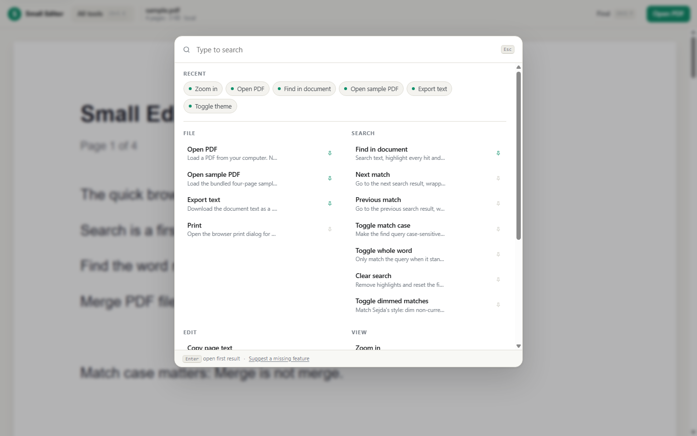
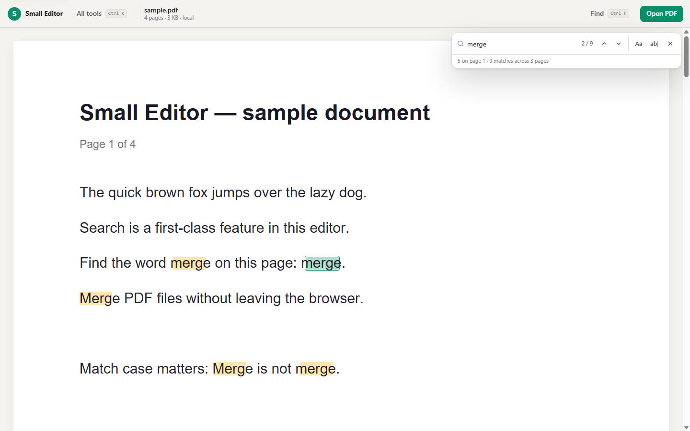

# Small Editor

A small, local-first PDF reader whose search is modelled on what sejda.com actually ships:
a **dim-in-place tool palette** and a **document find bar** with occurrence-level highlights.

Nothing is uploaded. pdf.js parses the PDF in the tab; recents/pins live in `localStorage`.

| Tools palette | Find in document |
|---|---|
|  |  |

*Palette in dark theme: `site-re/sites/sejda-com/captures/small-editor-palette-1440-dark.png`.*

## Quick start

```bash
npm install          # pdfjs-dist is vendored into app/vendor; pdf-lib only generates the fixture
npm test             # 16 unit tests, no browser
npm start            # http://127.0.0.1:5173/app/
```

- Open `http://127.0.0.1:5173/app/#sample` to auto-load the bundled fixture.
- `Ctrl K` / `Ctrl F` open the two search surfaces.
- `node scripts/browser-check.mjs` runs 14 end-to-end checks in headless Chrome
  (starts its own Chrome on port 9337; the server must be running).
- `npm run sample` regenerates `samples/sample.pdf`.

## Investigation dossier and reconstructed PoC

The Sejda public-behaviour investigation is in `reports/`; the current index is
`reports/README.md`. It covers **44/44 structured tool routes**, **7/41 observed
task types**, **5/6 representative workflow families**, and a documented
download-template trap.

A separate, independent Java PoC is in `reconstructed-backend/`. It uses Apache
PDFBox (not the Sejda SDK) and implements **9/9 bounded task types**; six are
verified against observed public behaviour and three are inferred from static
forms. The publicly observed `encrypt` task is outside that bounded PoC. It is
local-only and is not part of this app.

## Features

| Area | Behaviour |
|---|---|
| Open | File picker or drag-and-drop; sample PDF; multi-page rendering via pdf.js |
| Tool search | Incremental case-insensitive substring filter over title, description, category and keywords |
| Dimming | Non-matching rows stay in place at `opacity: .1` — Sejda’s treatment, no reflow |
| Pins / recents | Pin tools to the top; recent commands are recorded; both persist; strip capped at 13, recents at 12 |
| Find | Counts every occurrence, paints all hits, one current hit, page-scoped status |
| Find options | Match case (off), whole word (off), wrap-around, `Enter` / `Shift+Enter` |
| Navigation | Lazy page rendering, fit-width, zoom, first/last page, jump to match |
| Extras | Text export, copy page text, dark theme, print, keyboard shortcuts |

## Search model

The rebuild deliberately separates *what matches* from *how it is drawn*:

```
app/js/core.js      pure: filterTools, findInDocument, buildLines, geometryForRange,
                          rectToCss, stepIndex, paletteEntries, pushRecent, togglePin
app/js/app.js       DOM: palette, pdf.js viewer, find controller, highlights
```

### Tool palette (Sejda parity)

- Empty/whitespace query restores everything.
- Otherwise a case-insensitive substring test over caption + description + category + keywords.
- Every row is rendered all the time; non-matches are dimmed, never removed or reordered.
- No result count, no ranking, no fuzzy matching — the same absence of features as the source.
- One deliberate change: the query is **trimmed** for matching (on sejda.com, a leading space
  matches nothing because the blank check trims but `indexOf` does not).
- One usability addition: if the first live result is below the fold, the palette scrolls it
  into view without changing order.

### Document find (improved)

Sejda’s editor counts **matching text lines**, not occurrences, and highlights the whole line.
Small Editor counts and highlights **occurrences**, with a box per word fragment, and keeps a
single strong “current” marker. Case-insensitive by default; Match case and Whole word are
explicit toggles; navigation wraps.

Sejda’s Replace behaviour (replaces every occurrence inside the matched line) is documented in
`site-re/sites/sejda-com/report.md` but is **not** implemented here — this is a reader, not a
PDF writer.

### How highlights are computed

1. `page.getTextContent()` → items with `str`, `transform`, `width`.
2. `buildLines()` clusters items by baseline, inserts a space for visual gaps, and records
   `{start, end, x, baselineY, width, size}` per glyph run.
3. `findInPage()` returns character ranges, mapped by `geometryForRange()` into proportional
   rectangles per run.
4. `rectToCss()` flips PDF bottom-left coordinates into CSS pixels at the current zoom.
5. Every rect becomes an absolutely positioned `.hit`; the current one gets `.current`.

Limitations: rotated/skewed runs are approximate; the page flip assumes an unrotated page; a
case-fold that changes string length (e.g. Turkish `İ`) can shift offsets.

## Layout

```
app/
  index.html            markup for both searches
  css/app.css           light/dark themes, dimming, highlights, palette
  js/core.js            pure search core
  js/tools-data.js      20 commands with keywords
  js/app.js             palette + viewer + find controller
  vendor/pdfjs/         pdf.mjs, worker, cmaps, standard fonts
samples/sample.pdf      deterministic 4-page fixture
scripts/make-sample.mjs fixture generator (pdf-lib)
scripts/browser-check.mjs end-to-end checks
test/core.test.mjs      unit tests
server.mjs              zero-dependency static server
site-re/                reverse-engineering ledger for sejda.com
```

## Keyboard

| Keys | Action |
|---|---|
| `Ctrl K` | Open / close tools |
| `Ctrl F` or `/` | Find in document |
| `Enter` | Next match (in find) / open first result (in palette) |
| `Shift Enter` | Previous match |
| `Esc` | Close palette, then find |
| `Tab` / `Shift Tab` | Cycle palette controls (focus is trapped) |

## Privacy

- No network requests after the page loads, except the local static assets.
- No analytics, cookies, accounts or upload endpoint.
- The PDF is read with `File.arrayBuffer()` / `fetch` from the local server only.
- Recents, pins, theme and dim preference use `localStorage` and fail silently if blocked.

## Evidence

The reverse-engineering write-up for sejda.com lives in
[`site-re/sites/sejda-com/report.md`](site-re/sites/sejda-com/report.md), with a claims ledger,
inventory, unknowns, hashed artifacts and the exported REA bundle. Start there if you want the
“why” behind the behaviour above.

## License

No license file yet; treat this as a local prototype.
