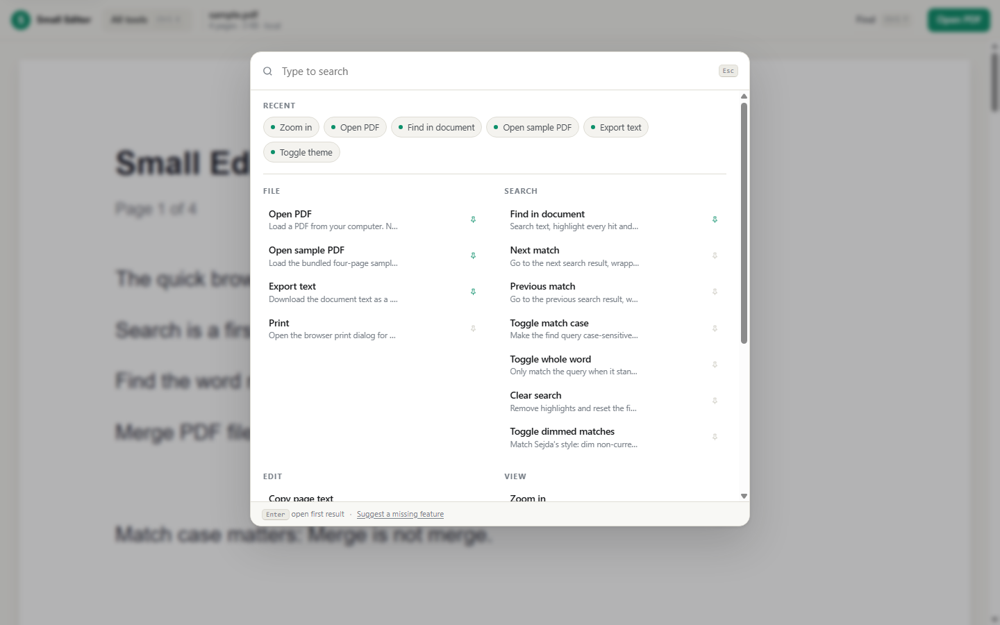
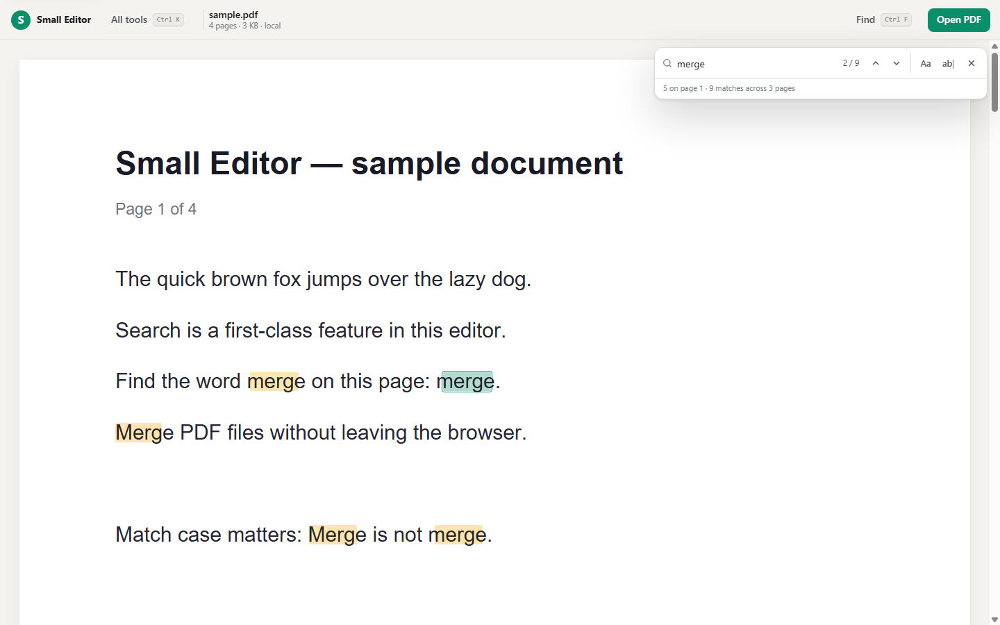

# How search works on sejda.com

**Scope:** the word “search” on sejda.com means two unrelated systems. They are analysed separately.

1. **Tool search** inside the header’s “All Tools” mega-menu — a client-side substring filter that *dims* non-matching tools to 10% opacity.
2. **Find & Replace** inside the PDF editor — a document search over a page’s text layer, with page/line-level match counting and in-place replacement.

Everything below is tied to `claims.csv`; evidence IDs resolve through the site manifest, the bounded-pass/static/workflow manifests under `reports/evidence/`, and `site-re/evidence/sejda-search-2026-10-24.bundle.json`.

---

## 0. Method and its limits

- **No plain HTTP.** Cloudflare answers `curl` with HTTP 403 and a block page [C-0040]. The real HTML, JS and CSS were fetched **through the loaded Chrome tab** (`tools/fetch-in-page.mjs`) or captured with REA. The 403 page is kept only as an artifact, never as evidence about the site.
- **Static reading.** The shared bundle `/cache/654/js/libs-and-partials.min.js` is 803,543 bytes [C-0044]. The tool-search handler and the recents/pins subsystem live there and are quoted verbatim below.
- **Runtime probing.** A CDP driver (`tools/cdp.mjs`) opened the menu, examined the input, forced the hidden input visible (an explicit intervention), and typed queries through the shipped `keyup` handler. Results are in `raw/probe-search.json`.
- **Editor.** A deterministic 4-page fixture (`samples/sample.pdf`) was uploaded through the page’s real file input; the hidden “Find & Replace” menu item then became reachable. Status text, highlights, cycling and replacement were observed. Results are in `raw/editor-find-observations.json`.
- **One rendering.** 1440×900, en-US, UTC, light, reduced motion, service workers blocked, logged out. This is not “the site”; it is one deterministic render.

---

## 1. The two search surfaces at a glance

| | Tool search | Editor Find & Replace |
|---|---|---|
| Where | Header → All Tools (`#megaMenu`) | Editor toolbar → text group caret |
| Input | `#searchTools`, placeholder “Type to search” | `#findText`, placeholder “Find” |
| Trigger | `keyup`, no debounce [C-0009] | Find button, Enter, or Replace button |
| Scope | 49 rendered anchors (44 unique tools) [C-0003/C-0004] | Current document’s text layer |
| Matching | Case-insensitive substring over rendered text + tooltip [C-0010/C-0011] | Case-insensitive by default; optional Match case [C-0026] |
| Output | Non-matches stay in place at `opacity:.1` [C-0013] | Status line + one line-level highlight [C-0029] |
| Counts | None [C-0014] | “Found N matches on page P” [C-0025] |
| Network | None in the handler [C-0014] | None observed for find; editor itself is a web app |
| Reachability | Input is **hidden** in this render [C-0007] | Only after a document is loaded [C-0023] |

---

## 2. Tool search

### 2.1 The markup

The server ships the search field inside the mega-menu partial:

```html
<div style="display: none" class="input-group search-tools-wrap">
  <input id="searchTools" type="search" placeholder="Type to search">
  …
</div>
```

[C-0006/C-0007]

In the captured render the wrapper keeps its inline `display:none` after the menu opens, at both 1440 px and 390 px [C-0007]. Playwright therefore refuses to fill it and an 8-second action times out [C-0008]. The field is present, wired, and **not visible** — why is unknown [C-0049].

### 2.2 The handler, verbatim

Extracted from `libs-and-partials.real.js` (SHA-256 `17dea15b…`):

```js
n.keyup(function () {
  var t = n.val().toLowerCase(),
      o = e.find("li a");
  0 != t.trim().length
    ? (
        o.addClass("search-not-matching"),
        o.each(function () {
          var e = $(this),
              n = (e.text() || "").toLowerCase(),
              o = (e.attr("title") || e.attr("data-original-title") || "").toLowerCase();
          (n.indexOf(t) >= 0 || o.indexOf(t) >= 0) && e.removeClass("search-not-matching");
        })
      )
    : o.removeClass("search-not-matching");
});
```

That is the entire search engine: **no index, no tokenizer, no scoring, no result list** [C-0009–C-0014].

### 2.3 Word by word

The handler is small but the minifier reuses single-letter names, and **three of them shadow outer variables**. Reading it literally:

| Token | Binding | Meaning |
|---|---|---|
| `n` | outer `n = $("#searchTools")` | The search input (still visible here; inside the loop `n` is shadowed). |
| `e` | outer `e = $("#megaMenu")` | The menu root (shadowed inside the callback). |
| `t` | `n.val().toLowerCase()` | Query, lowercased. **Not trimmed** for the actual comparison. |
| `o` | `e.find("li a")` | All anchors in the menu — including the five cloned “Recent” items. |
| `0 != t.trim().length` | — | “Is the query non-blank?” Whitespace-only is treated as empty. |
| `o.addClass("search-not-matching")` | — | Pessimistic pass: dim **everything** first. |
| `o.each(...)` | — | Optimistic pass: undim anything that matches. |
| `e = $(this)` | shadows menu | Current anchor. |
| `n = (e.text() || "").toLowerCase()` | shadows input | Haystack 1: all rendered text in the anchor, which is **caption + description + “New” badge**. |
| `o = (e.attr("title") || e.attr("data-original-title") || "").toLowerCase()` | shadows anchor list | Haystack 2: the tooltip. A later block copies `.description` into `title`, so this is usually the same description. |
| `n.indexOf(t) >= 0 \|\| o.indexOf(t) >= 0` | — | Plain substring test, either haystack. |
| `e.removeClass("search-not-matching")` | — | Undim on a hit. |
| `: o.removeClass(...)` | — | Blank query → undim all. |

Consequences that are easy to miss:

- **Leading/trailing spaces are fatal.** Only the *blank check* trims; `indexOf(t)` uses the raw lowercased string. `" merge"` therefore matches nothing, while `"   "` resets the view.
- **Descriptions are searchable.** `"pdf"` matches 37 of 49 anchors because nearly every description says “PDF” [C-0015].
- **Duplicates are searchable too.** `"merge"` returns 2 anchors: the Recent clone and the main entry [C-0015].
- **No normalisation.** No accent folding, stemming, token boundaries, synonyms or fuzzy matching.
- **No debounce.** Every keyup writes/removes classes across 49 anchors.
- **No a11y.** No live region, no count, no “no results” announcement.

### 2.4 The CSS: dim, don’t hide

```css
.mega-menu li a.search-not-matching { opacity: .1 }
```

[C-0013]

Non-matching tools remain in their original grid position, still clickable, at 10% opacity. The layout never reflows, so users keep their spatial memory of the menu; the trade-off is that matches can sit far below the fold [C-0013]. The screenshot `captures/tools-search-merge-1440.png` shows “merge” with the rest of the catalogue ghosted.

### 2.5 Observed behaviour

The input was forced visible and driven with the shipped handler. “Matched” = anchors without the dim class:

| Query | Matched anchors | Note |
|---|---:|---|
| `merge` | 2 | Recent clone + main Merge |
| `pdf` | 37 | Descriptions dominate |
| `delete` | 1 | “Delete Pages” only |
| `image` | 9 | Includes “images”, “Extract Images” |
| `sign` | 3 | Edit clone, Edit, Fill & Sign |
| `xyzzy` | 0 | Everything dimmed; no empty state |
| `"  "` (two spaces) | 49 | Reset branch (trimmed length 0) |
| `PDF` | 37 | Same as lowercase → case-insensitive |

[C-0015/C-0016]

### 2.6 Recents and pins (the other half of the menu)

The same closure implements the “Recent” column:

```js
Sejda.RememberedTools = function (t) {
  const n = {};
  function o(e) { Sejda.LocalStorage.setItem(t, JSON.stringify(e)) }
  return n.get = function () {
      try { return JSON.parse(Sejda.LocalStorage.getItem(t)) || [] } catch (e) { return [] }
    },
    n.add = function (t) {
      if (e.find("a").toArray().some(function (e) { return e.getAttribute("href").endsWith("/" + t) })) {
        var a = n.get();
        a.indexOf(t) >= 0 || (a.unshift(t), o(a = a.slice(0, 12)))
      }
    },
    n.remove = function (e) { … },
    n;
};
const r = Sejda.RememberedTools("prevUsedTools"),
      s = Sejda.RememberedTools("pinnedTools");
```

- **Storage keys:** `prevUsedTools` and `pinnedTools` [C-0017].
- **Recents cap:** 12 — `slice(0, 12)` [C-0018].
- **Strip composition:** `pinned.concat(recent).concat(defaults)`, dedupe by first occurrence, `slice(0, 13)` [C-0018].
- **Defaults:** `compress-pdf`, `pdf-editor`, `extract-pdf-pages`, `merge-pdf`, `crop-pdf` [C-0019].
- **Pin semantics:** pinning removes from recents; unpinning re-adds to the front [C-0020].
- **Validation:** an id is only recorded if some anchor’s `href` ends with `/<id>` — stale localStorage ids cannot inject arbitrary entries.
- **Implicit recent:** after the strip is built, the code takes the last path segment of the current URL and `r.add()`s it, so visiting a tool page records it.
- **Failure mode:** reads are wrapped in `try/catch`; a blocked localStorage silently yields an empty list (and the defaults still show).

The strip clones whole `<li>` nodes, appends a pin button, and marks them `pinned` or `recently-used`. This is why the search sees duplicates.

### 2.7 What the tool search is *not*

- Not a site-wide search: `/search`, `/all-tools`, `/tools` all return 404 [C-0042].
- Not server-side: the handler only touches classes [C-0014].
- Not ranked: results keep DOM order.
- Not a typeahead: no suggestion list, no keyboard result navigation.
- Not reachable in the captured render because the input is hidden [C-0007/C-0049].

---

## 3. Editor Find & Replace

### 3.1 UI

`/pdf-editor` ships a hidden modal [C-0021]:

| Element | Detail |
|---|---|
| `#searchReplaceTextPrompt` | Modal, `display:none` until invoked |
| Title | “Find & Replace” |
| `#findText` | Find field, placeholder “Find” |
| `#replaceText` | Replace field |
| `replaceMatchCase` | Checkbox “Match case”, default **unchecked** |
| `replaceMatchLinks` | Checkbox “Include links”, default **checked** |
| `.btn-find-next` | “Find” |
| `.btn-replace-find-next` | “Replace” |
| `.btn-replace-all` | “Replace all” |
| `#searchStatus` | Status line |

[C-0021/C-0022]

The menu item is invisible until a document is loaded; uploading the fixture made it reachable [C-0023]. Opening it on the fixture placed the Find input at roughly 199×34 px [C-0024].

### 3.2 Observed semantics

| Query | Match case | Status |
|---|---|---|
| `merge` | off | Found 3 matches on page 1 |
| `merge` | on | Found 2 matches on page 1 |
| `Merge` | off | Found 3 matches on page 1 |
| `Merge` | on | Found 2 matches on page 1 |
| `search` | off | Found 1 match on page 1 |
| `SEARCH` | off | Found 1 match on page 1 |
| `quick` | off | Found 1 match on page 1 |
| `the` | off | Found 3 matches on page 1 |

[C-0025–C-0028]

**Why 3 and not 5?** The fixture’s page 1 contains “merge” five times, on three text lines:

1. `Find the word merge on this page: merge.` → 2 occurrences
2. `Merge PDF files without leaving the browser.` → 1 occurrence
3. `Match case matters: Merge is not merge.` → 2 occurrences

Case-insensitive = **3 matching lines**, and the status says 3 [C-0025/C-0027]. With Match case on, only lowercase lines 1 and 3 remain → 2 [C-0026]. Page 2’s `merge merge merge` on a single line likewise yields **1**, and page 4 yields 1 [C-0027]. So:

> **The editor counts matching text lines/runs, not occurrences.** The count is page-scoped: “Found N matches on page P”.

Cycling proceeds in page order and wraps: clicks 1–3 are page 1, click 4 page 2, click 5 page 4, then back to page 1 [C-0028].

### 3.3 Highlight and replacement

- Exactly **one** `.find-replace-highlight` exists for the current match. In the fixture it spanned the whole matched line (284.6 px wide at 15.33 px font) rather than the word [C-0029]. No per-occurrence boxes were present.
- Pressing **Replace** with `REPLACED` produced `Replaced match 1 on page 1` and rewrote **every** occurrence inside that matched line: `Find the word REPLACED on this page: REPLACED.` [C-0030].
- Therefore Replace appears to operate on the matched text run/line, not on a single occurrence. “Replace all” was not exercised.

### 3.4 Why the implementation is opaque

The editor bundle is obfuscated and a literal grep finds none of the DOM ids it obviously uses [C-0045]. The behaviour above is runtime-observed, not read from source; the exact algorithm, tokenisation and layout heuristics remain unknown [C-0046]. Empty/regex queries could not be characterised: that probe sequence wedged the page’s main thread for 120 s [C-0047]. “Include links” is untested [C-0048].

---

## 4. Backend surface and the Java claim

### 4.1 What is actually in hand

| Layer | Obtained? | Detail |
|---|---|---|
| Public HTML | yes | homepage, editor, pricing, desktop, workflows, API, developers, help, teachers, 404 page |
| Public JS/CSS | yes, minified | 803,543 B shared bundle; 394,992 B editor bundle; 162,057 B CSS |
| Source maps | **no** | no `sourceMappingURL` in either bundle |
| API contract | partial | upload-check, upload, `POST /api/tasks`, `GET /api/tasks/{id}/change` and a signed ZIP download were exercised on 2026-10-25; password/touch/cancel/delete/chunked paths remain source-only [C-0053, C-0058–C-0066] |
| Task lifecycle | yes, one split task | `upload-check -> upload -> POST /api/tasks -> change -> result -> download`; four PDFs produced from the 4-page fixture [C-0059–C-0063] |
| Backend source / JAR / WAR | **no** | nothing server-side exists in the workspace. The public Sejda **SDK** source was reviewed separately; it is a Java PDF library, not the web backend. |
| Database, queue, storage, auth, payments, deployment | **no** | not public and not exercised |

**I do not have the complete application.** The client half is reproducible from the public site; the server half cannot be downloaded from it. What can be verified about the server is limited to its public HTTP behaviour.

### 4.2 Observable backend contract

| Endpoint | Method | Observed/source | Response |
|---|---|---|---|
| `/api/files/upload-check` | POST (form `uplid`) | exercised | `200 application/json` → `{"status":"ok"}` |
| `/api/files/upload?_s=&uplid=…` | POST (multipart `file`, `X-FileLocalId`) | exercised | `200 application/json` → `{"id":"<uuid>-<suffix>_<counter>"}` |
| `/api/tasks` | POST (JSON) | exercised | `200 application/json` → `"<task-id>"` (bare JSON string) |
| `/api/tasks/{id}/change?_=…` | GET | exercised | `200 application/json` → `status:"Completed"` + result metadata |
| `/api/tasks/{id}/download/{filename}?s=…` | GET (signed) | exercised | `200` → ZIP or PDF result |
| `/api/files/{id}/password` | POST | source only | not exercised |
| `/api/files/{id}/touch` | POST | source only | not exercised |
| `/api/files/upload-chunked` | POST | source only | not exercised |
| `/api/tasks/{id}/cancel` | POST | source only | not exercised |
| `/api/tasks/{id}` | DELETE | source only | not exercised |
| `/api/files`, `/api/tasks` | GET | exercised | custom HTML 404 (these are not GET routes) |

[C-0053/C-0054/C-0058–C-0066/C-0074–C-0078]

The 2026-10-25 split task used a JSON payload of the form `{"type":"splitByPages","step":"1","pages":"all","outputFilenamePattern":"[BASENAME]-[CURRENTPAGE]","files":["<file-id>"],"uri":"/split-pdf","specificResultFilenames":["","","",""]}` plus client build/telemetry fields (`userAgent`, `cvts`, `pdfjs`, `libsCache`, `consoleLogs`, `traceId`, `www`). The response was the bare string task id. The subsequent `/change` call returned `Completed`, `resultItems` `["sample-1.pdf","sample-2.pdf","sample-3.pdf","sample-4.pdf"]`, and a signed `resultFullUrlPattern`. The downloaded ZIP was 6,881 bytes and contained those four PDFs; the task metadata had reported `resultFileSize` 6,896, a 15-byte difference that is unexplained [C-0060–C-0063].

The first free task response carried `X-RateLimit-Remaining: 2` and `X-RateLimit-Wait: 3599`; the client text says free users get 3 tasks/hour [C-0062]. The upload/task/change responses set no `Set-Cookie`; no `Authorization` header or CSRF token field was visible [C-0064]. CORS allowed `https://www.sejda.com` with credentials; other headers included `X-Firefox-Translate: disable`, `X-Frame-Options: SAMEORIGIN` and `Cache-Control: no-cache, private, no-store, no-transform`. The download token is a short-lived capability and is redacted in the report.

After the first free-tier wait elapsed, three further tasks were submitted in the same logged-out browser session without clearing cookies or rotating identities: `splitByBookmarks` (level 1, title filter `Chapter`), `alternateMix` (default order) and `encrypt` (`aes_256`). The split returned three section PDFs with page counts 1, 2 and 1 in a 6,083-byte ZIP; alternateMix returned one 8-page 5,285-byte PDF in default A1/B1 order; encrypt returned one 4-page 4,046-byte AES-256 PDF (`/V 5`, `/R 6`, `/Length 256`, `/AESV3`) that rejected missing and wrong passwords. The responses repeated the remaining sequence 2, 1, 0 with waits 3,599, 3,483 and 3,443 seconds. Downloads were 13, 11 and 2 bytes smaller than the reported metadata sizes; the cause is unexplained [C-0074–C-0078].

The step-2 choice cards displayed “12 pages / 12 docs” for the 4-page fixture, while the actual task produced four PDFs; the choice text appears stale/static in this path [C-0065]. Full request/response detail and the redacted evidence excerpt are in `reports/20-bounded-rea-pass.md`.

Every response carries `server: cloudflare`. None carried `Set-Cookie`; the browser held only `clientId`, `_s` and `lang`, all non-HttpOnly, and **no `JSESSIONID` was ever observed** [C-0055]. The 404 page is Sejda’s own HTML, not a framework error page [C-0056].

### 4.3 Could the backend be Java?

It is **plausible but unverified**:

- In favour: server-side PDF processing, JSON REST endpoints, UUID-style file ids, `application/json;charset=utf-8`.
- Not Java-specific: every one of those traits is shared by Node, Python, .NET and Go services.
- Against a quick fingerprint: no `JSESSIONID`, no `X-Powered-By`, no `X-Application-Context`, no Tomcat/Jetty banner, no Spring `Whitelabel Error Page` [C-0056].
- Cloudflare replaces the origin `Server` header and Sejda’s custom 404 hides the framework, so the negative is weak evidence, not proof.

**Verdict:** the **web backend** Java claim is a reasonable hypothesis, but this investigation did **not** verify it [C-0057]. The official `torakiki/sejda` repository is separately confirmed to be a **Java PDF SDK/engine**, but it contains no web/API/auth/data layer and therefore does not establish the web service's runtime. The 2026-10-25 bounded API pass added task/download responses but still showed only `Server: cloudflare` and no Java/framework fingerprint [C-0064/C-0066]. Verifying the web backend requires a **web-layer** artifact (JAR/WAR/source), a stack trace, or a framework-leaking response — none of which the public client exposes. See `reports/19-official-sejda-sdk-review.md` and `reports/20-bounded-rea-pass.md`.

## 5. Products and services found around search

The menu is also the product catalogue: **44 unique tools in 11 named groups** [C-0003/C-0004]. The full table with routes and descriptions is in `inventory.md` §4.1. Summary:

| Group | Tools |
|---|---|
| Recent (clones) | Compress, Edit, Extract Pages, Merge, Crop |
| Merge | Merge, Alternate & Mix, Organize |
| Split | Extract Pages, Split by pages, Split by bookmarks, Split in half, Split by size, Split by text |
| Edit & Sign | Edit, Fill & Sign, Create Forms, Delete Pages |
| Compress | Compress |
| Security | Protect, Unlock, Watermark, Flatten |
| Convert from PDF | PDF to Excel, PDF to JPG, PDF to PowerPoint, PDF to Text, PDF to Word |
| Convert to PDF | HTML to PDF, JPG to PDF, Word to PDF |
| Other | Bates Numbering, Create Bookmarks, Crop, Edit Metadata, Extract Images, Flip, Grayscale, Header & Footer, N-up, Page Numbers, Rename, Repair, Resize, Rotate, Remove annotations |
| Scans | Deskew, OCR |
| Automate | Workflows (BETA) |

Commercial surface [C-0034–C-0039]:

- Web: Week Pass $5 / 7 days; Monthly $7.50; Desktop+Web Annual $63 (30% saving claim); free tier with “No signup required. Limited usage and features”.
- Desktop: $7.95 week pass; $63/year; business section with no rendered price.
- HTML→PDF API: seven monthly tiers from $12/200 docs to $768/9600 docs, unlimited document size, self-hosted option.
- Free for education; Workflows beta; developer docs; help centre.

Only 42 of the 44 menu routes appear in `sitemap.xml`; `/delete-pdf-annotations` and `/page-numbers-pdf` do not [C-0032].

---

## 6. What was built in `D:\small_editor`

A local-first PDF reader with the two search surfaces above, implemented from scratch on pdf.js 4.10.38 with no framework and no backend:

```
app/
  index.html          two search surfaces + find bar
  css/app.css         Sejda-like dimming, highlights, dark theme
  js/core.js          pure search core (unit-tested)
  js/tools-data.js    20 command entries (title/description/keywords)
  js/app.js           palette, PDF viewer, find controller
  vendor/pdfjs/       pdf.js + worker + cmaps + standard fonts
samples/sample.pdf    deterministic 4-page fixture
test/core.test.mjs    16 unit tests
scripts/browser-check.mjs  14 end-to-end checks in real Chrome
server.mjs            zero-dependency static server
```

### 6.1 Behaviour mapping

| Sejda observation | Rebuild | Note |
|---|---|---|
| Dim non-matches to 10% | Same: `.tool-row.is-dim { opacity: .1 }` | Visible in the palette screenshot |
| Keep all items and order | Same | No reflow, no hiding |
| Match caption + description | Same, plus explicit keywords and group name | Searchable synonyms such as “clipboard” |
| Case-insensitive substring | Same (`fold` = `toLowerCase`) | |
| Blank query resets | Same | Now also trims for matching (fixes the leading-space trap) |
| Pins + recents, 12 / 13 caps, defaults | Same algorithms in `core.js`, localStorage | Pin/unpin logic unit-tested |
| Current page becomes recent | Same idea: running a command records it | |
| No result count | Same | Deliberate parity |
| Hidden search input | **Not copied** — the palette is reachable with `Ctrl K` | The site’s hidden input is treated as a defect |
| Line-level editor counting | **Improved**: occurrence-level matches | Counts differ by design |
| One whole-line highlight | **Improved**: word-level boxes for every hit, current hit outlined | |
| Replace | **Not implemented** | Out of scope; the observed semantics are documented above |
| Match case | Same, default off | |
| Include links | Not applicable | |
| — | Added whole-word matching, wrap-around navigation, remembered dim setting, dark theme, text export | |

### 6.2 Search core

`app/js/core.js` is pure and side-effect free:

```js
filterTools(tools, query)        // [{tool, matching}] — keeps order, never removes
findInPage(pageModel, query, o)  // occurrence matches + PDF-space rects
findInDocument(models, query, o) // page-ordered flat list
geometryForRange(line, s, e)     // proportional boxes across glyph runs
rectToCss(rect, pageHeight, scale)
stepIndex(current, total, dir)   // wrap-around
paletteEntries({pinned, recent, defaults})
pushRecent / togglePin
```

Text geometry: pdf.js text items are grouped into visual lines (baseline clustering, gap-based spaces, right-to-left x-jump detection), characters are mapped back to glyph runs, and each match becomes one or more rectangles. The viewer renders pages lazily with `IntersectionObserver`, draws canvas + overlay, and converts PDF bottom-left coordinates into CSS pixels.

### 6.3 Screenshots

- Palette (light, empty query): `captures/small-editor-palette-1440.png`
- Palette (dark): `captures/small-editor-palette-1440-dark.png`
- Find “merge”: `captures/small-editor-find-1440.png` — 5 hits on page 1, 9 across 3 pages, current hit outlined





### 6.4 Verification

```
$ npm test
16/16 pass   (node --test, pure core)

$ node scripts/browser-check.mjs
14/14 checks pass
  sample loads (4 pages, indexed)
  "merge" → 9 occurrences, 1/9, pages 1,2,4
  all hits painted, exactly one current
  navigation wraps
  match case → 7
  whole word + phrase search
  palette keeps 20 rows, 17 dimmed at 0.1
  first live result scrolled into view
  pin persists to localStorage
  Escape closes palette then find
  no console errors
```

### 6.5 Run it

```bash
cd D:\small_editor
npm install          # already done; pdf.js is vendored
npm test
npm start            # http://127.0.0.1:5173/app/
npm run sample       # regenerate samples/sample.pdf
```

Open `http://127.0.0.1:5173/app/#sample` to load the fixture automatically. `Ctrl K` opens tools, `Ctrl F` opens find, `Enter` / `Shift+Enter` cycle matches.

---

## 7. Evidence index

| What | Where |
|---|---|
| REA bundle (3 retained records) | `site-re/evidence/sejda-search-2026-10-24.bundle.json` |
| Homepage, menu open, search dimming | `ev_4073c716…`, `ev_d6c5e8b7…`, `art_cf706b43…` |
| Hidden input failure | `ev_f97b3cdb…` |
| Tool handler source | `art_17dea15b…` (803,543 B) |
| Opacity rule | `art_f3d5a8be…` |
| Query matrix | `art_9d3944df…` |
| Editor markup | `art_e13a2c04…` |
| Editor search observations | `art_8a99c539…` |
| Editor screenshots | `art_068373d6…`, `art_b0a086ba…` |
| Backend headers/cookies/404 | `art_d2e5a61d…` |
| Upload API responses | `art_47c57f36…` |
| Products/prices | `art_c5ef10a4…`, `art_8316d6c6…`, `art_2c04102d…` |
| Route map | `art_8558ddab…`, `art_39e1ea6c…` |
| All artifact hashes | `evidence-manifest.csv` |
| Claims ledger | `claims.csv` |
| Unknowns | `unknowns.md` |

Reproduce the two runtime probes:

```bash
# tool search (requires Chrome on :9333)
cd site-re/sites/sejda-com && node tools/probe-search.mjs <targetId>

# editor find observations were collected with tools/cdp.mjs + tools/upload.mjs
node tools/upload.mjs <targetId> "input.fileupload" "D:\small_editor\samples\sample.pdf"
node tools/cdp.mjs <targetId> "<expression>" --screenshot captures/x.png
```
